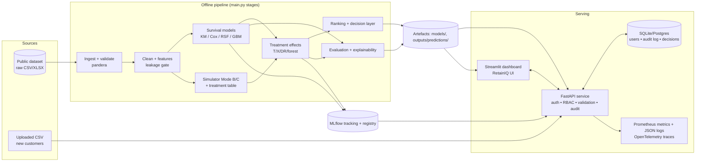
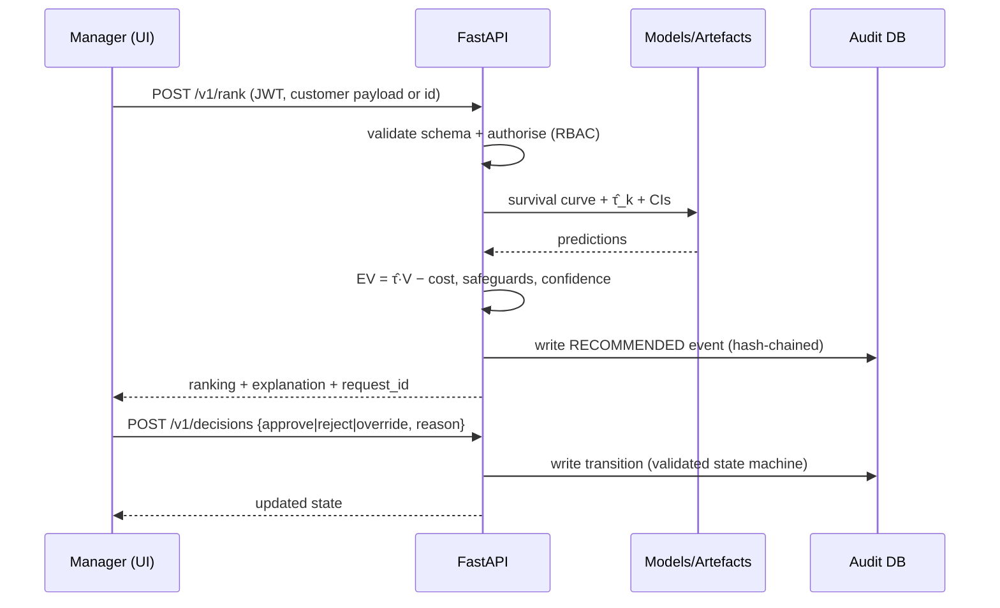

# PRD — BDS-11 | Survival-Based Churn Modeling with Personalized Retention Treatment Ranking

| Field | Value |
|---|---|
| **Project code** | BDS-11 |
| **Programme** | T.Y. B.Sc. Data Science – Semester V, Dept. of IT & Data Science, KES' Shroff College (AY 2026-27) |
| **Team** | 1–3 students (maximum 3) |
| **Effort rule** | Minimum 100 documented hours per student |
| **Maturity target** | Industry prototype — TRL 4 to 5 |
| **Innovation layer** | Causal / uplift analysis that separates association from actionable intervention effects |
| **Product working name** | **RetainIQ** — *when will they leave, and what actually keeps them?* |
| **Document status** | v1.0 – build specification (no results are claimed in this document) |
| **Repo layout** | `survival-churn/` (as mandated by the project prompt; extended, never reduced) |

> **Honesty clause (applies to the whole project).** This PRD specifies *what to build and how to evaluate it*. It contains **no model performance numbers, no treatment effects and no dataset results**. Every number that appears in the README, report, dashboard or demo must be produced by the code in this repo from a logged run. Thresholds in this PRD are *pre-registered targets*, not findings.

---

## Table of Contents

1. [Purpose, Problem and Mandate](#1-purpose-problem-and-mandate)
2. [Requirements Traceability (Brief + Prompt → PRD)](#2-requirements-traceability)
3. [Goals, Non-Goals, Scope Exclusions](#3-goals-non-goals-scope-exclusions)
4. [Stakeholders, Personas, User Stories, Misuse Cases](#4-stakeholders-personas-user-stories-misuse-cases)
5. [Product Experience: Interactive Dashboard (UX + Visual Design)](#5-product-experience-interactive-dashboard)
6. [Data Strategy](#6-data-strategy)
7. [Data Pipeline: Cleaning, Features, EDA, Leakage Checks](#7-data-pipeline)
8. [Survival Modeling](#8-survival-modeling)
9. [Churn-Time Prediction (30/60/90/180 days)](#9-churn-time-prediction)
10. [Treatment Effect Estimation (Innovation Layer)](#10-treatment-effect-estimation-innovation-layer)
11. [Personalized Treatment Ranking and Decision Layer](#11-personalized-treatment-ranking-and-decision-layer)
12. [Explainability](#12-explainability)
13. [Visualization Catalogue](#13-visualization-catalogue)
14. [Robustness, Leakage Prevention, Assumptions, Limitations](#14-robustness-leakage-prevention-assumptions-limitations)
15. [System Architecture and Repository Structure](#15-system-architecture-and-repository-structure)
16. [API and Data Contracts](#16-api-and-data-contracts)
17. [Security, Privacy and Responsible AI](#17-security-privacy-and-responsible-ai)
18. [MLOps, Observability, CI/CD, Deployment](#18-mlops-observability-cicd-deployment)
19. [Testing Strategy](#19-testing-strategy)
20. [Evaluation Dossier and Go / No-Go Criteria](#20-evaluation-dossier-and-go--no-go-criteria)
21. [Deliverables Checklist](#21-deliverables-checklist)
22. [Work Plan, Roles, Hours](#22-work-plan-roles-hours)
23. [Build Order (Step-by-Step Implementation Guide)](#23-build-order)
24. [Risks and Mitigations](#24-risks-and-mitigations)
25. [Appendices](#25-appendices)

---

## 1. Purpose, Problem and Mandate

### 1.1 Industry problem (from the capstone brief)
Binary churn models do not indicate **when** customers are likely to leave, nor how **censored** (still-active) accounts should be handled. The project must deliver a **working, stakeholder-testable prototype**, not a presentation-only concept.

### 1.2 What the product does
RetainIQ is an end-to-end system that:

1. Predicts **when** a customer is likely to churn (time-to-event), not just **whether**.
2. Estimates each customer's **survival (retention) probability over time**.
3. Evaluates different **retention treatments** using **causal / uplift** methods.
4. Produces a **personalized ranking of treatments per customer** based on *expected incremental impact net of cost* — never on predicted churn risk alone.
5. Delivers a **decision layer** (customer-level output table + plain-language explanation), a **dashboard**, an **API**, an **audit trail** and **operational monitoring**.

### 1.3 Mandate from the brief — must integrate
Cohort analysis · survival curves · feature engineering · Cox or survival models · risk segments · intervention scenarios · dashboard — plus the innovation layer (causal/uplift). It must run on realistic or safely simulated data, handle failures and edge cases, preserve security and privacy, and expose measurable evidence through **concordance index, calibration by time horizon, lift, stability and interpretability**, demonstrating a full workflow **from data/event intake → decision → user action → audit trail → operational monitoring**.

### 1.4 Four concepts that must stay separate (project prompt)
| Concept | What it answers | Where it lives | Never claim |
|---|---|---|---|
| **Correlation / prediction** | Which features are associated with leaving? | Feature importance, SHAP, Cox coefficients | "X causes churn" |
| **Survival probability** | How likely is this customer to still be active at time *t*? | `survival_models.py` | "Will definitely churn" |
| **Treatment effect** | How much does treatment *k* change retention vs. no treatment? | `treatment_effects.py` | Effects from non-causal data |
| **Causal claim** | Is that effect credible? | Only under stated assumptions + validation (§10, §14) | Causality without randomization or adjustment evidence |

UI, README and report must label every output with its concept type (badges: `PREDICTION`, `SURVIVAL`, `TREATMENT EFFECT (ESTIMATED)`, `SIMULATED`).

---

## 2. Requirements Traceability

Every requirement from the capstone brief (BDS-11) and the build prompt is mapped to a PRD section. Use this table as the final completeness check.

### 2.1 Capstone brief → PRD

| Brief requirement | PRD § |
|---|---|
| Validate workflow/pain points of subscription businesses & customer-success teams; personas, misuse cases, success criteria, NFRs, Agile backlog | 4, 19, 22, App. C |
| Modular architecture & data model: cohort analysis, survival curves, feature engineering; API/data contracts, authentication, authorization, auditability, failure handling | 15, 16, 17 |
| Complete operational workflow: Cox/survival models, risk segments, intervention scenarios, dashboard; realistic state transitions; role-based user journeys | 5, 8, 11, 16.4 |
| Innovation: causal/uplift separating association from actionable effects; compare to simpler baseline/manual process; document where advanced adds value | 10, 20.3 |
| Production controls: automated tests, input validation, secrets mgmt, dependency checking, CI/CD, containers, logs/metrics/traces | 17, 18, 19 |
| Evaluation: C-index, calibration by time horizon, lift, stability, interpretability; stress/robustness tests; subgroup/edge-case analysis; limitations; go/no-go criteria | 8.4, 14, 20 |
| Deliverable: industry problem brief (stakeholder map, current-process evidence, user stories, misuse cases, scope exclusions, risks, success metrics, backlog) | 3, 4, 24, App. C |
| Deliverable: solution design pack (C4, sequence/data-flow, schema, API contracts, UI prototype, threat model, test strategy) | 5, 15, 16, 17, 19 |
| Deliverable: integrated MVP (cohort, survival curves, feature engineering, Cox/survival, risk segments, intervention scenarios) | 5–11 |
| Deliverable: innovation module + comparison study (baseline results, experiment config, failure analysis) | 10, 20.3 |
| Deliverable: data/model package using public telecom/subscription datasets with tenure & churn status (provenance, permissions, data dictionary, versioning, simulator protocol, reproducible setup) | 6, 18 |
| Deliverable: engineering evidence pack (issue board, branches/PRs, code review, unit/integration tests, dependency scan, container image, CI, release notes) | 18, 19, 21 |
| Deliverable: evaluation dossier (C-index, calibration by horizon, lift, stability, interpretability; thresholds; edge cases; load/latency; security/privacy; responsible AI) | 20 |
| Deliverable: deployable demo (OpenAPI or model/system card, admin & user guide, 5–8 min demo video, final report, presentation, individual contribution evidence) | 21 |
| Acceptance gates: not CRUD-only/dashboard-only/copied notebook/API wrapper; ≥1 baseline comparison; ≥1 failure/security/robustness experiment; clean-machine/container run; no secrets or personal data committed; operational evidence; leakage checks, reproducible splits, baselines, explainability/error analysis, model/system card | 14, 17, 18, 20, 21 |
| Suggested stack: Python, pandas/Polars, scikit-learn, XGBoost/LightGBM, Jupyter, MLflow, FastAPI, Streamlit/Power BI, Git, statsmodels, sktime/lifelines, lifelines/scikit-survival | 15.3 |
| Alignment references: OWASP API Security Top 10, OpenTelemetry, SLSA, NIST AI RMF | 17, 18 |
| Evaluation weights (10/15/25/15/15/10/10) | 21.2 |
| Allocation & approval checklist | App. B |

### 2.2 Build prompt → PRD

| Prompt requirement | PRD § |
|---|---|
| Dataset: customer ID, tenure, event, demographics/behaviour, subscription/transaction, treatment info; cleaning, missing-value, outlier, feature engineering, EDA, leakage checks; explain limits and build defensible survival/treatment variables without leakage | 6, 7 |
| Survival: Kaplan-Meier, Cox PH, Random Survival Forest, neural survival if justified; survival curves, hazard estimates, individual predictions, horizon churn probabilities | 8 |
| Metrics: concordance index, integrated Brier score, time-dependent AUC; explain why each is appropriate | 8.4 |
| Churn-time: S(30/60/90/180), expected/median survival where appropriate; censored ≠ churned | 9 |
| Treatment ranking: discount, personalized offer, loyalty reward, support intervention, product recommendation, no intervention; T/S/X-learner, causal forest, uplift; method selected by data & justified; Expected Retention Value formula; don't rank by churn probability | 10, 11 |
| Decision layer columns: `customer_id, churn_risk, survival_30d, survival_90d, survival_180d, recommended_treatment, treatment_effect, expected_value, confidence` + explanation of selection | 11.5–11.6 |
| Explainability: SHAP, feature importance, PDP; why elevated risk; which features affect survival; why a treatment ranked high; no causal claims from predictive models | 12 |
| Visualizations (8 listed) | 13 |
| Robustness: temporal leakage, post-churn features, treatment leakage, censoring, selection bias, confounding, train/test contamination; temporal/out-of-sample validation; document assumptions & limitations | 14 |
| Implementation: Python + pandas, numpy, scikit-learn, lifelines, scikit-survival, matplotlib, seaborn, shap, causal/uplift libs; mandated folder structure | 15 |
| Deliverables list (runnable code, acquisition instructions, EDA pipeline, training/eval, treatment effects, ranking engine, visuals, example predictions, README, methodology/assumptions/limitations/business interpretation) | 21 |
| Important: no fabricated results; state unsupported analyses; keep prediction/survival/treatment/causal separate; reproducible seeds; clean-environment runnable; inspect dataset/environment first; write the code and produce real outputs | 1.4, 6.5, 14, 23 |

---

## 3. Goals, Non-Goals, Scope Exclusions

### 3.1 Goals
| ID | Goal | Measured by |
|---|---|---|
| G1 | Time-to-churn modeling that treats censoring correctly | Censored rows never labeled as churn; unit tests (§19) |
| G2 | Individual survival curves and horizon probabilities (30/60/90/180 d) | `survival_*` columns valid & monotone non-increasing |
| G3 | Survival models compared against baselines on a leakage-checked, reproducible split | C-index, IBS, time-dependent AUC, calibration by horizon (§20) |
| G4 | Treatment effect estimation that separates association from intervention effect | Uplift/Qini + ground-truth recovery in simulation (§10.6) |
| G5 | Per-customer treatment ranking driven by incremental effect × value − cost | Ranking ≠ risk ranking (verified by comparison study) |
| G6 | Interactive, attractive, easy-to-use dashboard with role-based journeys | Usability walkthrough (§20.6), demo video |
| G7 | Production-grade engineering: tests, API, container, CI, logging, audit, monitoring | Engineering evidence pack (§21) |
| G8 | Transparent about limitations | Limitations register + model/system card |

### 3.2 Non-goals
- Not a CRUD portal, dashboard-only submission, copied notebook, or API wrapper (explicitly non-acceptable per the brief).
- Not a claim of real-world causal discovery from observational telecom data.
- Not an automated customer-contact system (no emails/SMS are sent; the system *recommends* and records human decisions).
- Not a billing/CRM replacement.

### 3.3 Scope exclusions (document in the final report)
Real-time streaming ingestion · production-scale (>1M customers) optimization · multi-tenant SaaS billing · real customer PII · reinforcement-learning/bandit treatment policies (listed as future work) · fairness *remediation* beyond subgroup auditing.

---

## 4. Stakeholders, Personas, User Stories, Misuse Cases

### 4.1 Stakeholder map
| Stakeholder | Interest | Influence |
|---|---|---|
| Customer-success / retention manager | Decide who to contact, with what offer, within budget | High (primary user) |
| Retention analyst / data scientist | Validate models, explore cohorts, audit effects | High |
| Marketing / finance owner | Offer cost, ROI, budget caps | Medium |
| Platform administrator / ML engineer | Deploy, monitor, manage users and model versions | Medium |
| Compliance / privacy officer | Data minimisation, audit trail, no PII leakage | Medium |
| Customers (indirect) | Fair, non-intrusive treatment | Indirect |
| Faculty examiners / viva panel | Evidence of originality, rigor, individual ownership | Evaluation |

### 4.2 Personas (role-based journeys)
| Persona | Role in app (RBAC) | Journey |
|---|---|---|
| **Riya – Retention Manager** | `manager` | Overview → Campaign Planner (set budget, horizon) → review top customers → approve/reject/override → export approved list |
| **Arjun – Retention Analyst** | `analyst` | Cohort & Survival Explorer → Model Lab → Treatment Studio → Evaluation dossier → file feedback on model |
| **Meera – Platform Admin** | `admin` | Users/roles, model registry (MLflow), monitoring & drift, audit log, retrain trigger |
| **Viewer / Auditor** | `viewer` | Read-only dashboards + audit log |

### 4.3 User stories (initial backlog seed — prioritised MoSCoW)
| ID | Story | Priority |
|---|---|---|
| US-01 | As a manager I see overall retention curve and KPIs (active, at-risk, expected churners in next 90 d) on one screen | Must |
| US-02 | As an analyst I compare survival curves across segments (contract, tenure band, service type) with log-rank p-values | Must |
| US-03 | As a manager I open a customer and see their survival curve, 30/60/90/180-day retention and risk segment | Must |
| US-04 | As a manager I see ranked retention treatments per customer with expected incremental retention, cost and net value | Must |
| US-05 | As a manager I set a campaign budget and get the customer–treatment allocation that maximises expected net value | Must |
| US-06 | As an analyst I see why a customer is high-risk (SHAP) and why a treatment ranks high, with a clear "association, not causation" notice | Must |
| US-07 | As a manager I approve, reject or override a recommendation and the action is audit-logged | Must |
| US-08 | As an analyst I change treatment costs/customer-value assumptions in a what-if simulator and see rankings update | Must |
| US-09 | As an analyst I compare Cox vs RSF vs boosted survival vs baseline on C-index/IBS/AUC(t)/calibration | Must |
| US-10 | As an admin I view logs, API metrics, data drift (PSI) and model version in a monitoring page | Must |
| US-11 | As a user I upload a CSV of new customers and get validated, scored output (or clear validation errors) | Should |
| US-12 | As an analyst I see the Go/No-Go acceptance scoreboard | Should |
| US-13 | As a user I get a guided tour and tooltips explaining every metric in plain language | Should |
| US-14 | As an analyst I switch between *Real-observational* and *Semi-synthetic (known truth)* data modes | Should |
| US-15 | As an admin I export a model card / system card | Should |
| US-16 | Dark/light theme toggle | Could |

### 4.4 Misuse / abuse cases
| ID | Misuse | Mitigation |
|---|---|---|
| MU-01 | User reads treatment effect as a proven causal fact | Badges, caveat banners, assumptions panel, simulated-vs-real labelling |
| MU-02 | Targeting only highest-risk customers ("persuadables" ignored; "sure things"/"sleeping dogs" treated) | Ranking by incremental effect; negative-effect flagging; "do not treat" outcome |
| MU-03 | Uploading malformed/malicious CSV (formula injection, huge file, wrong schema) | Pydantic/pandera validation, size/row caps, CSV-injection sanitising on export |
| MU-04 | Unauthorised access to customer-level data | Auth, RBAC, rate limiting, pseudonymised IDs, no PII in repo |
| MU-05 | Silent tampering with recommendations | Append-only audit log with hash chain (§17.4) |
| MU-06 | Discriminatory treatment allocation (e.g., by gender/senior-citizen status) | Sensitive attributes excluded from treatment *decision* features by default; subgroup audit of allocation |
| MU-07 | Leakage-driven inflated metrics shown to stakeholders | Automated leakage gate in pipeline blocks training if triggered |
| MU-08 | Over-trusting low-confidence recommendations | `confidence` column; low-confidence → defaults to "No intervention / review" |
| MU-09 | API abuse (brute-force, mass enumeration, BOLA/IDOR) | OWASP API Top 10 controls (§17) |
| MU-10 | Secrets committed to the repo | `.env` ignored, pre-commit secret scan, CI check |

### 4.5 Non-functional requirements
| ID | Requirement | Target (pre-registered) |
|---|---|---|
| NFR-01 | Reproducibility | Fixed seeds; `make reproduce` regenerates all figures/tables from a clean environment |
| NFR-02 | Single-customer API latency | p95 < 500 ms on a laptop-class machine (measure & report, don't assume) |
| NFR-03 | Batch scoring throughput | Report customers/sec; target ≥ 500/s for survival scoring (measure) |
| NFR-04 | Dashboard first load | < 5 s using cached artefacts (no retraining on page load) |
| NFR-05 | Test coverage | ≥ 80% on `src/` core logic |
| NFR-06 | Dependency hygiene | `pip-audit` clean or documented exceptions |
| NFR-07 | Accessibility | Colour-blind-safe palette, text alternatives for charts, keyboard-navigable controls where Streamlit permits |
| NFR-08 | Portability | Runs via `docker compose up` and via plain `pip install -r requirements.txt` |
| NFR-09 | Observability | Structured JSON logs, Prometheus-style metrics, request IDs, model-version tags |

---

## 5. Product Experience: Interactive Dashboard

**Design intent:** *very interactive, a little advanced, but easy to use, and visually attractive.* The dashboard is the "front door"; every page must read well to a non-statistician and still offer depth for an analyst ("Simple by default, advanced on demand").

### 5.1 Technology choice
**Streamlit (multipage) + Plotly** for interactive charts, backed by the **FastAPI** service for scoring/audit and **MLflow** for model registry. Power BI is an acceptable *secondary* view of exported prediction tables but is **not** the primary deliverable. Heavy computation (training, SHAP, bootstraps) is done **offline by `main.py`** and cached as artefacts in `models/` and `outputs/`; the UI loads artefacts and performs only light recomputation (what-if re-ranking, budget allocation).

### 5.2 Visual design system
| Token | Spec |
|---|---|
| **Theme** | Dark "analytics studio" default (deep navy `#0B1220` background, card surface `#121B2E`), light theme toggle |
| **Primary** | Electric teal `#14B8A6` (survival / retention = good) |
| **Accent** | Violet `#8B5CF6` (treatment / uplift), Amber `#F59E0B` (caution / medium risk), Coral `#F43F5E` (high risk / negative effect) |
| **Colour-blind safety** | Never rely on red/green alone; pair colour with icons/labels; verify palette with a simulator |
| **Typography** | Inter (UI) + JetBrains Mono (numbers/IDs); consistent scale (32/24/18/14/12) |
| **Components** | KPI "metric cards" with sparkline, rounded 14 px cards, soft shadow, pill badges for risk segments and concept type, consistent Plotly template (`retainiq_template`) used on **all** figures |
| **Motion** | Subtle transitions only (no heavy animation); skeleton loaders while artefacts load |
| **Iconography** | One icon set (Lucide/Material) used consistently |
| **Empty/error states** | Friendly messages with next-step buttons (never raw stack traces) |

Implement the theme in `app/theme.py` (Streamlit `config.toml` + injected CSS + shared Plotly template) so one change restyles the product.

### 5.3 Information architecture (pages)
| # | Page | Purpose | Key interactions |
|---|---|---|---|
| 0 | **Login & Role Switch** | Auth, role-based navigation | Demo accounts via env-configured secrets; session timeout |
| 1 | **Home / Executive Overview** | KPIs: customers, censoring rate, median survival, expected churners ≤ 90 d, portfolio-level expected net value of recommended campaign; mini-KM curve; risk-segment donut; "What should I do today?" call-to-action | Global filters (segment, contract, tenure band, date range if available); guided-tour button |
| 2 | **Data & Quality** | Provenance, license, data dictionary, missing-value heatmap, outlier plots, **leakage audit report** (pass/fail per check), data mode badge (Real / Semi-synthetic) | Column-level drill-down; download dictionary |
| 3 | **Cohort & Survival Explorer** | Overall KM + curves by segment with CI bands, **risk table**, log-rank / multivariate log-rank p-values, cumulative hazard, smoothed hazard, cohort retention heat-map | Multi-select segments, "compare any two", toggle CI/hazard/censor ticks, click-to-export PNG/CSV |
| 4 | **Model Lab** | Compare Cox PH, Weibull AFT (optional), RSF, gradient-boosted survival, optional neural survival, KM baseline, naïve binary-churn baseline | Metric table (C-index, IBS, AUC(t)), calibration-by-horizon plots, time-dependent AUC curve, PH-assumption diagnostics, model selector with "why this metric" popovers |
| 5 | **Customer 360** | Single customer: profile, risk segment, personal survival curve (with uncertainty band if available), 30/60/90/180-day retention, SHAP waterfall, **treatment ranking bars**, plain-language explanation | Customer search/select; compare two customers; "simulate treatment" toggle that overlays counterfactual survival curves (**labelled ESTIMATED**) |
| 6 | **Treatment Studio (What-if)** | Edit costs, customer-value definition, horizon, margin; see CATE distributions per treatment and how rankings change | Sliders/number inputs → instant re-ranking; sensitivity tornado of top-1 treatment stability |
| 7 | **Campaign Planner** | Budget-constrained allocation (maximise Σ expected net value) with optional per-treatment capacity caps; uplift/Qini & cumulative-gain curves; expected-vs-baseline policy comparison | Budget slider, capacity caps, objective toggle; "Approve all / review one-by-one"; export approved list |
| 8 | **Review & Audit** | State-machine workflow: `Scored → Recommended → Approved / Rejected / Overridden → Executed → Outcome-recorded`; audit trail table with hash-chain verification | Approve/reject/override with mandatory reason; filter by user/date/customer |
| 9 | **Evaluation & Go/No-Go** | Pre-registered thresholds vs observed values (traffic-light scoreboard), baseline comparison study, robustness/stress results, subgroup analysis | Drill into each gate; download dossier |
| 10 | **Monitoring** | API latency/error metrics, data-drift (PSI/KS) per feature, score-distribution drift, calibration-over-time (if outcomes arrive), model version & MLflow link | Time-window picker; alert thresholds |
| 11 | **Docs & Model Card** | Methodology, assumptions, limitations, glossary, user & admin guide, model/system card, OpenAPI link | Search; download PDF/MD |

### 5.4 "Easy to use" requirements
- **Guided tour** (first launch) and **preset scenarios** ("Budget-tight month", "Win-back focus", "High-value protect").
- **Plain-language summaries** auto-generated above every chart (e.g., "Customers on month-to-month contracts are estimated to retain at 60 days with probability X vs Y for annual contracts") — values filled from computed results, never hard-coded.
- **Tooltips / "Why this metric?"** popovers for C-index, IBS, AUC(t), calibration, uplift, Qini, SHAP.
- **Consistent concept badges** (`PREDICTION`, `SURVIVAL`, `TREATMENT EFFECT (ESTIMATED)`, `SIMULATED`).
- **One-click exports** (CSV of predictions, PNG of figures, PDF/MD of customer explanation).
- **Responsive layout** for laptop and projector; keep ≤ 3 primary actions per page.

### 5.5 Advanced-but-optional features ("a little advanced")
Counterfactual survival-curve overlay · sensitivity tornado · budget optimiser · segment auto-discovery (shallow decision tree on CATE for "who benefits from what") · confidence gauge per recommendation · model-vs-baseline "value added" panel · natural-language explanation generator (template-based, deterministic; **no LLM required**).

### 5.6 Role-based access
| Capability | viewer | analyst | manager | admin |
|---|---|---|---|---|
| View dashboards | ✔ | ✔ | ✔ | ✔ |
| Customer-level data | masked ID | ✔ | ✔ | ✔ |
| Change what-if assumptions | – | ✔ | ✔ | ✔ |
| Approve/override recommendations | – | – | ✔ | ✔ |
| View audit log | ✔ (read) | ✔ | ✔ | ✔ |
| Manage users / trigger retrain / view monitoring config | – | – | – | ✔ |

---

## 6. Data Strategy

### 6.1 Step 0 — Inspect before building (mandatory, per project prompt)
`main.py --stage inspect` (and `notebooks/00_environment_and_data_inspection.ipynb`) must:
1. Print Python/OS/library versions and verify `lifelines`, `scikit-survival`, `scikit-learn`, `shap`, causal libs import correctly.
2. Check the dataset file exists, hash it (SHA-256), record row/column counts, dtypes, duplicates, ID uniqueness.
3. Determine **what the dataset genuinely supports** and write `outputs/data_capability_report.json`:
   `has_tenure`, `has_event`, `has_calendar_dates`, `has_real_treatment`, `treatment_is_randomized (unknown/no)`, `has_transactions`, `has_post_outcome_columns`.
4. Select the **data mode** automatically from that report (§6.4) and **log why**.

### 6.2 Candidate public datasets (verify license, schema and availability at download time)
| Candidate | Why | Has real tenure/event? | Real treatment? | Notes |
|---|---|---|---|---|
| **Telco Customer Churn (IBM sample; widely mirrored on Kaggle)** — *primary candidate* | Subscription telecom, demographics + services + contract + charges, `tenure` (months) + `Churn` | Yes (tenure in **months**, churn flag; right-censored = still active) | **No** | ~7k rows; known quirk to verify: `TotalCharges` blanks for zero-tenure customers; tenure is monthly (limits sub-month resolution) |
| **Telco churn extended variants (e.g., Maven Analytics / IBM extended)** — *candidate* | May include an `Offer` column, `Customer Status`, satisfaction/score/CLTV/churn-reason columns | Yes | Possibly a promotional *Offer* field — **observational, not randomized** | Contains **post-outcome / leakage columns** (e.g., churn reason, churn score, customer status) that must be blocked; confirm columns & license at download |
| **KKBox churn data (WSDM Cup)** — *stretch / temporal-validation dataset* | Real calendar dates, transactions, user logs → genuine temporal split | Derivable (subscription expiry / renewal) | Auto-renew / promotional plan fields are not randomized treatments | Large; check competition-rules license before use |

**Decision rule:** build everything on the *primary candidate*. Treat the extended variant's `Offer` field (if it exists and passes checks) as an *observational-treatment robustness study only*. Use KKBox only if time permits, for temporal-validation evidence.

### 6.3 What public data does **not** provide (state this explicitly in README + report)
- **No public telecom/subscription dataset (that we are aware of) contains randomized retention-treatment assignments with outcomes.** Observational offer columns, where present, are confounded by who the company chose to target and may suffer from **timing / immortal-time bias** (customers must survive until the offer date to receive it).
- Tenure in the primary dataset is **monthly** and there is a single snapshot: sub-month horizons (30 days) sit at the data's resolution limit (§9.3), and **left truncation / survivorship bias** is possible if customers who churned long before the snapshot are absent (verify; `lifelines` supports delayed-entry if entry times exist).
- Treatment **costs** are not in the data; they are **business assumptions** configured in `config/treatments.yaml` and always labelled as assumptions.

### 6.4 Data modes (switchable in the app, selected automatically in the pipeline)
| Mode | When used | Survival analysis | Treatment analysis | Claim strength |
|---|---|---|---|---|
| **A. Real survival, no treatment** | Always available | Real tenure/event | Not run on real data | Predictive/survival claims only |
| **B. Semi-synthetic, *randomized* treatment with known truth** | Default for treatment layer | Real covariates; durations from a documented generator | Treatments assigned by known random mechanism; **ground-truth CATE known** | Validates *estimator quality*, not real-world effect sizes — **labelled SIMULATED everywhere** |
| **C. Semi-synthetic, *confounded* treatment with known truth** | Stress-test | As B | Assignment depends on covariates (realistic targeting) → tests adjustment & overlap handling | As B |
| **D. Real observational `Offer` field** *(only if present)* | Robustness appendix | Real | Estimated under *unconfoundedness assumption* with propensity diagnostics | Association-adjusted estimate; **not** proven causal |

### 6.5 Semi-synthetic treatment simulator — protocol (`src/simulation.py`)
Goal: obtain realistic covariates **and** known potential outcomes so causal/uplift estimators can be validated without fabricating real-world effects.

1. **Index date design.** Define a decision point *t₀* per customer (their observed tenure at the snapshot) and a follow-up window. Treatments are applied at *t₀*; outcomes are residual survival from *t₀*. Treatment is therefore assigned **before** outcomes and uses only pre-*t₀* covariates (prevents treatment/temporal leakage).
2. **Baseline (control) process.** Fit a *generator* model to the real data — use a **different model family** from those later evaluated (e.g., Weibull AFT with a few interaction terms) so Cox/RSF do not trivially match the truth. Control survival `S₀(h | x, t₀)`.
3. **Treatment effects (heterogeneous, known).** For each treatment *k* define a log-hazard shift `τ_k(x)` with *documented* structure, deliberately including:
   - **Persuadables** (large benefit), **sure-things** (low risk, ~no benefit), **lost causes** (high risk, ~no benefit), and **sleeping dogs** (negative effect, e.g., aggressive discount to loyal annual customers who would have stayed).
   - Different treatments helping different segments (e.g., discount ↔ price-sensitive month-to-month; support intervention ↔ no tech-support/high-friction; loyalty reward ↔ long tenure; product recommendation ↔ low service adoption; personalised offer ↔ mixed).
   - Potential-outcome survival `S_k(h | x, t₀)` and **true CATE** `Δ_k(h|x) = S_k(h|x,t₀) − S₀(h|x,t₀)`.
4. **Assignment mechanism.** Mode B: uniform randomisation over {control + 5 treatments} (known propensity). Mode C: propensity depends on covariates (e.g., higher discount probability for high-charge customers) with **controlled overlap** (clip propensities to [ε, 1−ε]).
5. **Outcome generation.** Draw durations from the assigned arm's potential-outcome distribution; add **administrative censoring** at the end of follow-up and optional **random (non-informative) censoring**; record `time`, `event`.
6. **Quarantine ground truth.** `sim_true_cate_*`, `sim_S0`, `sim_Sk` are written to `data/processed/sim_truth.parquet` **only**. They must never enter feature matrices — enforced by the leakage gate (§7.5) and a unit test.
7. **Document everything.** Generator formula, all effect parameters, seeds, and the censoring scheme go into `docs/simulation_protocol.md` and the model card. The UI shows a persistent **SIMULATED** badge in modes B/C.
8. **Why this is defensible.** It lets us measure whether our estimators *recover known effects under known assumptions* (PEHE-style error, Qini vs oracle, policy regret) — evidence about **method quality** — while making **no claim** about real-world effect sizes.

### 6.6 Data package requirements (brief deliverable)
Provenance & permissions table (source URL, license, retrieval date, SHA-256) · data dictionary (`docs/data_dictionary.md`, auto-generated + hand-annotated) · versioning via **DVC or checksum-manifest** (`data/MANIFEST.json`) · `scripts/download_data.py` (or documented manual step if licence requires login) · raw data **never committed** (`.gitignore`), only schema and a **tiny synthetic sample** (`data/sample/`) for CI tests.

---

## 7. Data Pipeline

Implemented in `src/data_preprocessing.py` (+ `src/config.py`, `src/validation.py`), driven by `config/default.yaml`.

### 7.1 Required output tables
| Table | Contents |
|---|---|
| `customers_clean` | `customer_id`, `time` (duration), `event` (1 churned, 0 censored), cleaned features, `time_unit` |
| `customers_features` | Engineered features (§7.4), train/test indicators |
| `treatments` | (Modes B/C/D) `customer_id`, `treatment` ∈ {discount, personalized_offer, loyalty_reward, support_intervention, product_recommendation, none}, `t0`, propensity (if known) |
| `sim_truth` | Quarantined ground truth (Mode B/C only) |
| `splits` | Fixed split assignments saved to disk for reproducibility |

### 7.2 Cleaning
- Schema validation with **pandera** (types, ranges, allowed categories); fail loudly with actionable errors.
- ID uniqueness; duplicate handling (log & drop exact duplicates; investigate conflicting duplicates).
- Type coercion (e.g., `TotalCharges` blanks → NaN, never silently 0).
- Standardise categories ("No internet service" / "No phone service" collapsed into a documented `service_absent` level where appropriate).
- **Event coding:** `event = 1` only for observed churn; still-active customers are `event = 0` (right-censored) with `time = observed tenure`. **Zero-duration rows** are handled by an explicit, documented policy (e.g., set minimal positive time `ε` or exclude, with counts logged) because Cox/KM require positive times.

### 7.3 Missing-value and outlier analysis (deliverables → `outputs/figures/` + Data & Quality page)
| Analysis | Method | Output |
|---|---|---|
| Missingness profile | Per-column %, pattern matrix, missingness vs. event/time (MCAR/MAR sanity checks) | `missingness_report.csv`, heat-map |
| Imputation | Train-only fit: median/most-frequent + missing-indicator flags; compare with iterative imputation as sensitivity | Logged; **fit on training fold only** |
| Outliers | IQR/robust-z on continuous variables, winsorisation limits chosen on train only, domain checks (negative charges, tenure > plausible) | `outlier_report.csv`, box/violin plots |
| Decision log | Every cleaning decision recorded (rule, rows affected, rationale) | `outputs/cleaning_decisions.json` |

### 7.4 Feature engineering (pre-index information only)
- **Subscription features:** contract type, billing method, paperless billing, number of services subscribed, service-bundle flags (internet/phone/streaming/security/support), payment method.
- **Charges/value:** monthly charges, charges relative to peers in same service bundle (price-percentile), charge-per-service, `avg_monthly_spend = total_charges / max(tenure,1)` (**only if** not derived from outcome — see leakage note), spend-change ratio.
- **Tenure & lifecycle:** tenure band, **tenure is the duration, not a feature** in the survival models (use `tenure_at_index` as a covariate **only** in the treatment-layer, where the target is residual survival after *t₀*).
- **Demographic:** senior flag, partner/dependents, household features. *Sensitive attributes* (gender, senior citizen) are retained for **auditing**, flagged `sensitive=True`, and excluded from the treatment-*decision* feature set by default (configurable, documented).
- **Behavioural / friction proxies:** support-service flags, count of add-on services, bundle depth.
- **Encoding/scaling:** one-hot / ordinal encoders and scalers inside an sklearn `ColumnTransformer` **fit on train only**, serialised with the model (single artefact → no train/serve skew).
- Feature registry (`docs/feature_schema.md`): name, type, source, availability time, leakage-risk rating, sensitive flag.

### 7.5 Leakage checks (automated gate — `src/data_preprocessing.py::run_leakage_audit`)
The pipeline **stops** (non-zero exit, UI shows red) if any check fails. Results saved as `outputs/leakage_audit.json` and shown on the Data & Quality page.

| Check | Method |
|---|---|
| **Forbidden-column blocklist** | Fail if features include: churn label/value, churn reason/category, churn score, customer-status, cancellation date, post-churn refunds, `sim_*` truth columns, or anything in `config.forbidden_features` |
| **Outcome-derived features** | Flag features that are deterministic functions of time/event (e.g., `TotalCharges ≈ MonthlyCharges × tenure`); document correlation with duration and decide: drop or replace with pre-index alternatives |
| **Single-feature predictiveness test** | Univariate C-index / AUC for every feature; anything with suspiciously high discrimination (config threshold, e.g., > 0.85) requires manual review |
| **Timestamp ordering** | Where dates exist: feature timestamp ≤ index date < outcome date |
| **Treatment leakage** | Treatment assigned before outcome window; no post-treatment variables in features for effect estimation (post-treatment bias); treatment not predictable from outcome |
| **Train/test contamination** | Row-ID disjointness assertion; transformers/imputers/encoders/selected hyper-parameters fitted on train only; duplicate rows across splits check; same-customer-in-both-splits check |
| **Censoring consistency** | `event=0` rows never used as positives in any binary target; time > 0; censoring rate by split reported |
| **Shuffle-label sanity test** | Permute `time/event` pairing → C-index should be ≈ 0.5; if not, there's a pipeline leak |

### 7.6 Exploratory data analysis (notebook `01_eda.ipynb` + Explorer page)
Distribution of durations and censoring (by segment) · event rate vs features · cohort retention tables · correlation / Cramér's V / mutual information · Kaplan-Meier by key segments with log-rank tests · multicollinearity (VIF) · proportional-hazards preliminaries · **Selection-bias review** (who is in the dataset, left truncation, snapshot effects).

### 7.7 Splitting & validation design
- **Primary split:** Where calendar dates exist (KKBox/extended), use a **temporal split** (train on earlier index dates, test on later).
- **Without dates (primary Telco dataset):** stratified (by event & duration quantile) **train / validation / test = 60/20/20** with a fixed seed, plus **repeated stratified K-fold (5×3)** on train+val for tuning and stability measures. State plainly that this is *out-of-sample but not temporal* validation.
- Test set is **touched once** for final reporting (logged with a run ID); hyper-parameter tuning uses CV only.
- Splits are persisted (`data/processed/splits.parquet`) and hashed.
- For the treatment layer: split *customers* (not rows) and keep all arms balanced in each split; ground truth used **only** at evaluation time.

---

## 8. Survival Modeling

Implemented in `src/survival_models.py` behind a common interface (§8.5). Survival structure: `duration` (> 0), `event` (1 = churn observed, 0 = right-censored).

### 8.1 Models to implement and compare
| # | Model | Library | Role | Notes |
|---|---|---|---|---|
| M0a | **Kaplan–Meier** (overall + by segment) | `lifelines` | Non-parametric baseline; population curve; cohort analysis | Greenwood CIs; log-rank & multivariate log-rank tests; Nelson–Aalen cumulative hazard; smoothed hazard |
| M0b | **Naïve binary churn classifier** (logistic regression on `event`, ignoring time/censoring) | `scikit-learn` | **Deliberately flawed baseline** for the comparison study | Demonstrates *why* ignoring time/censoring misleads (it can't give time-to-churn and treats censored as non-churn) |
| M1 | **Cox Proportional Hazards** (penalised) | `lifelines` (`CoxPHFitter`) and/or `scikit-survival` (`CoxnetSurvivalAnalysis`) | Interpretable main model; hazard ratios | Check PH via Schoenfeld residuals (`proportional_hazard_test`); remedy violations by **stratification** or time-varying effects/AFT |
| M2 | **Weibull AFT** (optional) | `lifelines` | Parametric alternative; smooth extrapolation | Use cautiously beyond observed follow-up |
| M3 | **Random Survival Forest** | `scikit-survival` | Non-linear, interaction-capturing, no PH assumption | Tune `n_estimators, min_samples_leaf, max_features` via CV on train |
| M4 | **Gradient-boosted survival** | `scikit-survival` `GradientBoostingSurvivalAnalysis` **or** XGBoost/LightGBM survival objective | Brief's suggested boosting stack | Needs baseline-hazard estimation (Breslow) to produce S(t) — document |
| M5 | **Neural survival (DeepSurv / DeepHit-style) — *conditional*** | `pycox` / `torch` | Only if justified | **Justification gate:** dataset is small tabular (~thousands of rows); include only if (a) time permits and (b) it is compared fairly (same splits, tuning budget). If included and not better than M1–M4 on validation, **report that honestly** and keep it as an appendix experiment. Otherwise document "not justified: small tabular data, interpretability and calibration priorities". |

### 8.2 Outputs required
- **Survival curves:** overall, by segment, and individual.
- **Hazard estimates:** Cox hazard ratios (+CI), Nelson–Aalen cumulative hazard, kernel-smoothed hazard, Breslow baseline hazard.
- **Individual survival predictions:** `S(t | x)` on a common time grid for every customer.
- **Horizon churn probabilities:** `P(churn by h) = 1 − S(h | x)` at h ∈ {30, 60, 90, 180} days.

### 8.3 Training protocol
1. Fit all preprocessing on the **training fold only**.
2. Tune hyper-parameters by repeated stratified CV **on train+val**; log every trial to **MLflow** (params, metrics, artefacts, data hash, git commit, seed).
3. Select the **primary predictive model** using the *validation* metrics (primary criterion: IBS and Uno's C; tie-break: calibration), **before** opening the test set.
4. Refit on train+val, evaluate **once** on test; report mean + bootstrap CI.
5. All seeds from `config.seed` (default 42) → `numpy`, `random`, `sklearn`, model-specific seeds.

### 8.4 Evaluation metrics and why each is appropriate (in `src/evaluation.py`)
| Metric | What it measures | Why appropriate here | Caveats to document |
|---|---|---|---|
| **Concordance index** — Harrell's C and **Uno's C (IPCW, truncated at τ)** | Pairwise ranking: does the customer who churns earlier have the higher predicted risk? Handles censoring through comparable pairs | Right-censoring-aware generalisation of AUC; ranking is what retention teams use for prioritisation | Harrell's C is biased under heavy censoring → report Uno's C; says nothing about calibration or absolute probabilities |
| **Integrated Brier Score (IPCW)** (and Brier(t) curve) | Squared error of predicted `S(t|x)` vs. actual status, weighted for censoring, integrated over a time range | Evaluates **both calibration and discrimination** of full survival curves, which matter because we output probabilities | Needs an estimate of the censoring distribution (KM from train); integrate only over a range supported by test follow-up; compare to the **KM baseline Brier** (skill score = 1 − IBS/IBS_KM) |
| **Time-dependent AUC** (cumulative/dynamic) at 30/60/90/180 d | Discrimination between customers who churn by *t* vs. survive past *t* | Matches the business question ("who leaves within *h* days?") and shows how discrimination changes with horizon | IPCW-based; unstable at late horizons with few at-risk customers → show CIs and number-at-risk |
| **Calibration by time horizon** | At each horizon *h*, group customers by predicted `S(h)` (deciles) and compare with the **observed KM survival** within each group; plus calibration slope/intercept and an ICI-style summary (e.g., Austin-style hazard-regression calibration) | Predicted probabilities feed expected-value calculations → miscalibration directly distorts decisions | Needs adequate sample per group; report group sizes; optional D-calibration |
| **Lift / gain by horizon** | Observed churn rate (KM-based, censoring-aware) in the top risk decile/quintile vs. overall | Operational question: "how much better than random is targeting the top X%?" | Describes *risk targeting* — **not** treatment benefit (that is uplift, §10) |
| **Stability** | Bootstrap CIs for all metrics; repeated-CV variance; seed-to-seed variation; rank correlation (Spearman) of customer risk across resamples; PH-diagnostics stability; SHAP rank stability | Needed to know whether differences between models are real | Report distributions, not single numbers |
| **Interpretability** | Hazard ratios, permutation importance, SHAP stability, PDP sanity vs. domain knowledge | Brief requirement; builds stakeholder trust | Model explanation ≠ causal explanation (§12) |

### 8.5 Code contract (sketch)
```python
class SurvivalModel(Protocol):
    name: str
    def fit(self, X: pd.DataFrame, duration: np.ndarray, event: np.ndarray) -> "SurvivalModel": ...
    def predict_survival_function(self, X: pd.DataFrame, times: np.ndarray) -> np.ndarray:  # (n, len(times)), monotone non-increasing, in [0,1]
        ...
    def predict_risk_score(self, X: pd.DataFrame) -> np.ndarray: ...   # higher = earlier churn
    def predict_median_survival(self, X: pd.DataFrame) -> np.ndarray: ...  # NaN if curve never crosses 0.5 within support
```
All models must pass the same contract tests (monotonicity, bounds, shape, determinism under seed).

---

## 9. Churn-Time Prediction

### 9.1 Required per-customer outputs
`survival_30d`, `survival_60d`, `survival_90d`, `survival_180d`, `churn_prob_{h} = 1 − survival_{h}`, `median_survival_time` (where statistically appropriate), `rmst_180d` (restricted mean survival time), `risk_segment`.

### 9.2 Rules
1. **Censored ≠ churned.** Censored customers contribute follow-up time up to censoring and no event. They are never used as negatives in a binary target. A unit test constructs a dataset where treating censored as events would flip the answer.
2. **Conditional survival for active customers.** For a customer active at tenure `t₀`, the forward-looking horizon probability is `S(t₀ + h | x) / S(t₀ | x)` — **not** `S(h | x)`. This is the default in the decision layer; the unconditional version is shown only in cohort views.
3. **Median survival.** Report the median **only if the individual curve falls below 0.5 within the supported follow-up**; otherwise output `NaN` with label "> max follow-up". **Never extrapolate** the tail silently. Provide `rmst_180d` (restricted mean survival time up to a horizon) as the always-defined summary of expected time retained. Parametric (Weibull) medians beyond follow-up are shown only with an explicit "extrapolated" flag.
4. **Risk definition.** `churn_risk = 1 − survival_{h_risk}` with `h_risk = 90 d` by default (configurable, documented). **Risk segments** use thresholds fixed on the *training* distribution (e.g., quantile cut-points: Low / Medium / High / Critical), and are reported with their observed KM churn rates per segment (a calibration check).

### 9.3 Time-resolution handling (important, data-dependent)
The primary dataset's `tenure` is in **months**. Convert horizons with `months = days / 30.4375`. Between observed event times, interpolate the **cumulative hazard linearly** (equivalent to a piecewise-exponential assumption) and state this assumption. 30-day predictions are at the data's **resolution limit** (≈ 1 month) — the UI and report must flag that sub-month precision is not supported by the source data. A dataset with daily timestamps (e.g., KKBox) would remove this limitation.

---

## 10. Treatment Effect Estimation (Innovation Layer)

Implemented in `src/treatment_effects.py`. This layer is the project's distinguishing contribution: **it separates "who is likely to churn" (association/prediction) from "who will be retained *because of* an intervention" (effect).**

### 10.1 Estimand
For treatment *k* ∈ {discount, personalized_offer, loyalty_reward, support_intervention, product_recommendation} vs. control (*none*), decision horizon *h* (default 180 d, configurable):

**τ_k(x, h) = P(still active at t₀+h | x, do(treatment = k)) − P(still active at t₀+h | x, do(treatment = none))**

(Optional secondary estimand: difference in restricted mean survival time up to *h*.) The absolute change in survival probability is what feeds the Expected Retention Value (§11).

### 10.2 Identification assumptions (display in UI + report)
1. **Consistency / SUTVA** — one well-defined version of each treatment; no interference between customers.
2. **Conditional ignorability (unconfoundedness)** — given pre-treatment covariates, assignment is independent of potential outcomes. *Holds by design in Mode B (randomised); is an untestable assumption in Modes C/D.*
3. **Positivity / overlap** — every customer type has a non-zero chance of each arm.
4. **Non-informative censoring** conditional on covariates (and treatment).
5. **No post-treatment covariates** in the adjustment set.

### 10.3 Method candidates and selection logic
| Method | Library | Fit for this data |
|---|---|---|
| **S-learner (survival)** — one survival model with treatment (one-hot + interactions) as covariates | `scikit-survival` (RSF/GBM) or `lifelines` Cox with interactions | Simple; tends to *shrink* effects toward zero (treatment can be ignored by the learner) — keep as a baseline |
| **T-learner (survival)** — separate survival model per arm; τ̂ = Ŝ_k(h|x) − Ŝ_0(h|x) | `scikit-survival` | Natural for survival; flexible; high variance if an arm is small |
| **X-learner (IPCW pseudo-outcomes)** — impute individual effects per arm, then combine with propensity weights | `causalml` / `econml` or custom | Better when arms are imbalanced (typical for targeted offers) |
| **DR-learner / IPCW-transformed-outcome meta-learner** | `econml` | Doubly-robust; handles confounded assignment (Mode C/D) |
| **Causal forest on IPCW-transformed retention outcome** | `econml` `CausalForestDML` | Heterogeneity discovery + built-in inference. *Note:* the dedicated "causal survival forest" is an R (`grf`) method; in Python we approximate via the IPCW-transformed outcome and **say so** |
| **Uplift trees/forests** | `causalml` | Useful for segment discovery and Qini evaluation |

**Primary pipeline (expected):** T-learner and X-learner built on survival base learners, plus a DR/IPCW learner and a causal forest, all compared with the S-learner baseline. **The final choice is made empirically on the validation split** using criteria in §10.6 and **documented with reasons** — the PRD does not pre-declare a winner. Selection guide: randomised data (Mode B) → T/X/S all valid, prefer lowest validation error; confounded data (Mode C/D) → require propensity-adjusted learners (X/DR/forest) and overlap diagnostics.

### 10.4 Handling censoring in the treatment outcome
- Binary "retained at *h*" is **unobserved** for customers censored before *h*. Use the **IPCW-transformed outcome** `Y*_i = 1{retained status known} · R_i / Ĝ(min(U_i, h) | x_i, k_i)`, where `Ĝ` is the censoring survival function (KM or covariate-dependent), with **weight truncation** (e.g., cap at the 99th percentile) and a sensitivity check on the cap.
- Survival-model-based learners (T/S) use the censored data directly and avoid this transformation; comparing both families is part of the method study.

### 10.5 Propensity and overlap diagnostics (Modes C/D; sanity-check in B)
Multinomial propensity model (logistic + gradient boosting, cross-fitted) · overlap histograms per arm · **standardised mean differences before/after weighting** · effective sample size · flag customers outside the common-support region (`overlap_flag`) — these are routed to "review", not auto-recommended.

### 10.6 Validation of treatment-effect estimators
| Setting | Metric | Purpose |
|---|---|---|
| **Mode B/C (known truth)** | PEHE-style RMSE of τ̂ vs. true τ, per treatment | Direct accuracy of effect estimates |
| | Rank correlation (Spearman) of τ̂ vs. τ | Do we rank customers correctly for each treatment? |
| | **Qini / AUUC** vs. random and vs. **oracle** | Targeting value |
| | **Policy value & regret** of the recommended policy vs. oracle, random, risk-ranked and rule-based policies | Business value of the full ranking engine |
| | **CATE calibration** (decile predicted vs. true average effect) | Are effect magnitudes believable? |
| | **Sign accuracy** (esp. detecting *sleeping dogs*) | Avoid harmful treatment |
| | **Interval coverage** of bootstrap CIs vs. truth | Is `confidence` meaningful? |
| **Mode D (real observational)** | IPCW-weighted Qini (no truth) with CIs | Weak evidence only |
| | Placebo/negative-control outcome and placebo-treatment tests | Detect residual confounding |
| | Sensitivity analysis (e.g., E-value-style) for unmeasured confounding | Quantify fragility |
| **All modes** | Stability across seeds/resamples; subgroup effect checks | Robustness |

### 10.7 Uncertainty
Bootstrap (default B = 200; configurable lower for CI/CD) of the entire learner pipeline on the training set → per customer-treatment τ̂ distribution → CI and `P(EV > 0)`; cached to disk. Alternatively, forest-native intervals (`econml`) where available.

### 10.8 Comparison study (brief requirement: "compare with a simpler baseline or manual process; document where the advanced approach adds value")
| Policy | Definition |
|---|---|
| P0 | No treatment |
| P1 | Random treatment assignment |
| P2 | **Risk-ranked:** give a default treatment (e.g., discount) to the top-*q* highest churn-risk customers (the "obvious" approach — *what the prompt says not to do*) |
| P3 | **Manual rule:** e.g., discount to all month-to-month customers (a plausible current-process proxy; state that this is an assumed proxy, not observed company evidence) |
| P4 | Single-best-treatment-for-all (highest average effect) |
| **P5** | **RetainIQ:** per-customer argmax of expected retention value with CI/overlap safeguards |
| P-oracle | Uses true τ (simulation only) — upper bound |
Report value at several budget levels, regret vs. oracle, and **failure analysis**: where P5 loses to P2/P3 (e.g., low-overlap segments, tiny effects, mis-specified cost assumptions).

---

## 11. Personalized Treatment Ranking and Decision Layer

Implemented in `src/treatment_ranking.py` (+ `src/decision_layer.py`).

### 11.1 Treatments (configurable in `config/treatments.yaml`)
| Treatment | Example cost (**assumption**, editable) | Eligibility rules (editable) |
|---|---|---|
| `discount_incentive` | per-customer % of monthly charge × duration | Active, has paid ≥ 1 month |
| `personalized_offer` | fixed cost per contact | — |
| `loyalty_reward` | fixed | Tenure ≥ minimum months |
| `support_intervention` | agent time cost | Support capacity cap |
| `product_recommendation` | low fixed | Has ≥ 1 add-on eligible |
| `no_intervention` | 0 | Always eligible; **EV = 0 by definition** |

All costs are labelled **"business assumptions — not estimated from data"** in UI and docs; the what-if page lets users change them.

### 11.2 Customer value `V(x)`
Default (matches the prompt formula): `V(x) = monthly_margin(x) × H_months`, where `monthly_margin = monthly_charges × margin_rate` and `H_months` is the **same horizon as the effect estimate** (value realised inside the window; no extrapolation beyond it). Optional advanced toggle: replace the formula with `monthly_margin × ΔRMST` (time-in-window gained) or a discounted CLV with a configurable discount rate. Margin rate, discount rate and horizon are config values with documented defaults.

### 11.3 Expected Retention Value (per customer–treatment pair)
```
EV(x, k) = τ̂_k(x, h) × V(x) − cost_k          # k ∈ treatments
EV(x, none) = 0
```
Rank treatments by `EV` in descending order. Ranking is **never** done with churn probability alone: churn risk enters only *indirectly* — a high-risk customer with τ̂ ≈ 0 ("lost cause") or τ̂ < 0 ("sleeping dog") will not get a treatment.

### 11.4 Selection rules and safeguards
1. `recommended_treatment = argmax_k EV(x,k)` over eligible treatments (including *none*).
2. If best EV ≤ 0 → **no_intervention**.
3. If the lower CI bound of the best EV ≤ 0 **and** `confidence` < threshold → **"no_intervention (insufficient evidence)"** or route to **review**.
4. If `overlap_flag` is set (Modes C/D) → route to **review**; never auto-approve.
5. Respect business constraints: one treatment per customer, contact-fatigue window, capacity caps, budget (§11.7).
6. Sensitive attributes are not decision inputs by default; allocation is audited by subgroup (§17.5).

### 11.5 Final customer-level output (required schema)
| Column | Definition |
|---|---|
| `customer_id` | Pseudonymised ID |
| `churn_risk` | `1 − survival_{h_risk}` (default h = 90 d), conditional on current tenure |
| `survival_30d` | Conditional survival probability at 30 d |
| `survival_90d` | …at 90 d |
| `survival_180d` | …at 180 d |
| `recommended_treatment` | argmax-EV treatment after safeguards |
| `treatment_effect` | τ̂ of the recommended treatment at the decision horizon (absolute change in retention probability; **estimated**; `0` for *none*) |
| `expected_value` | EV of the recommended treatment (currency units; `0` for *none*) |
| `confidence` | Heuristic stability score in [0,1] (see below) + `confidence_label` (High/Medium/Low) |

Additional columns (not part of the minimum schema): `survival_60d`, `median_survival_time`, `rmst_180d`, `risk_segment`, `ev_<treatment>` and `rank_<treatment>` for every treatment, `tau_ci_low/high`, `overlap_flag`, `data_mode`, `model_version`, `explanation_text`, `review_status`.

**`confidence` definition (document precisely):** `confidence = min( share of bootstrap replicates in which the recommended treatment is top-ranked,  P(EV_recommended > 0) ) × overlap_factor`, where `overlap_factor ∈ (0,1]` shrinks for customers near the support boundary. It is a **stability/uncertainty score, not a calibrated probability that the recommendation is correct** — unless the simulation study shows empirical calibration, in which case that evidence is reported.

### 11.6 Explanation of how the recommendation was selected (auto-generated per customer)
Template (deterministic; values filled from computed results):
1. *Risk:* "Customer X has an estimated {survival_90d:.0%} chance of staying active for 90 more days (risk segment: {segment})." — **PREDICTION/SURVIVAL**
2. *Why risk is elevated:* top SHAP drivers (associations in the model). — **PREDICTION**
3. *Treatment effects:* table of τ̂_k with CIs for each treatment. — **ESTIMATED EFFECT**
4. *Value:* `τ̂ × V − cost` for each treatment and the resulting ranking.
5. *Decision:* chosen treatment, why *none* or others were not chosen (e.g., "discount: effect estimate ≈ 0 or negative for customers like this").
6. *Caveats:* data mode (SIMULATED / observational), overlap flag, confidence label, "effects are estimates under stated assumptions."

### 11.7 Campaign optimisation (Campaign Planner page)
Choose at most one treatment per customer to maximise `Σ EV` subject to total cost ≤ budget and per-treatment capacity caps — a multiple-choice knapsack solved with a greedy EV-per-cost heuristic and verified/solved exactly with `scipy.optimize.milp` or `PuLP`. Show expected net value, expected retained customers (± uncertainty) and comparison with P2/P3 policies.

### 11.8 State machine (for audit & role-based journey)
`SCORED → RECOMMENDED → (APPROVED | REJECTED | OVERRIDDEN[new treatment + reason]) → EXECUTED (manual flag; no automated contact) → OUTCOME_RECORDED`. Invalid transitions are rejected by the API (tested). Each transition writes an audit record (§17.4).

---

## 12. Explainability

Implemented in `src/explainability.py`.

| Question | Method | Notes / guardrail |
|---|---|---|
| Which features are associated with survival overall? | **Cox hazard ratios** (forest plot with CIs); **permutation importance** (drop in Uno's C on validation) for RSF/GBM; model-agnostic comparison across models | Association, not causation |
| Why does this customer have elevated churn risk? | **SHAP** on the survival risk score or on `S(h|x)`: `TreeExplainer` for boosted trees; `PermutationExplainer`/`KernelExplainer` with a small background sample for RSF/Cox; per-customer **waterfall**; global **beeswarm** | Report SHAP stability across bootstrap/seeds; warn about correlated features |
| How do features shape survival? | **Partial dependence / ICE** for top features on `S(h)`; segment KM curves | PDP can mislead with correlated features → show ICE & data-density rug |
| (Optional) Time-varying explanations | SurvSHAP(t)-style or SHAP at multiple horizons | Optional |
| Why was this treatment ranked highly? | Fit a **surrogate model on the estimated τ̂_k(x)** (e.g., gradient-boosted regressor) → **SHAP on τ̂**; plus a shallow **decision tree** on τ̂ to produce readable segment rules ("who benefits from what") | Explains *what the effect model learned*, **not** causal mechanisms; every explanation panel carries this banner |
| Are explanations trustworthy? | Rank-correlation of SHAP across seeds; sanity test with randomised labels (importances collapse) | Part of stability evidence |

**Language rules (enforced in UI strings & report):** use "is associated with", "model predicts", "estimated effect under assumptions". Never "causes", "drives" or "because of" for predictive-model outputs. Treatment-effect statements must name data mode and assumptions.

---

## 13. Visualization Catalogue

Static (matplotlib/seaborn, 300 dpi PNG → `outputs/figures/`) **and** interactive (Plotly in the app), generated by `src/evaluation.py` / `src/visualization.py`, all using the shared style.

| ID | Figure | Required by | App page |
|---|---|---|---|
| F01 | **Overall Kaplan–Meier survival curve** with CI, censor ticks, risk table | Prompt | Home, Explorer |
| F02 | **KM curves by important segments** (contract, tenure band, internet service, payment method, risk segment) with log-rank p-values | Prompt | Explorer |
| F03 | **Feature importance** (Cox HR forest plot + permutation importance + SHAP bar) | Prompt | Model Lab |
| F04 | **Churn-risk distribution** (histogram/violin by segment; overlaid by observed event) | Prompt | Home, Model Lab |
| F05 | **Treatment-effect distribution** (τ̂ per treatment, violin/ridge, with zero line; true τ overlay in sim) | Prompt | Treatment Studio |
| F06 | **Treatment ranking distribution** (share of customers with each treatment ranked #1; rank heat-map; Sankey from risk segment → recommended treatment) | Prompt | Campaign Planner |
| F07 | **Customer-level survival curves** (selected customer vs. population; counterfactual overlay per treatment, labelled ESTIMATED) | Prompt | Customer 360 |
| F08 | **Calibration by horizon** (30/60/90/180 d), **time-dependent AUC** curve, **Brier(t)/IBS vs KM baseline** | Prompt | Model Lab |
| F09 | Cumulative hazard & smoothed hazard | Brief/Prompt | Explorer |
| F10 | Schoenfeld / PH diagnostics | Brief | Model Lab |
| F11 | Missingness heat-map; outlier box plots | Prompt | Data & Quality |
| F12 | SHAP beeswarm + customer waterfall; PDP/ICE | Prompt | Model Lab, Customer 360 |
| F13 | Propensity overlap & SMD love plot | Brief | Treatment Studio |
| F14 | Qini / uplift curves; cumulative gain by policy | Brief | Campaign Planner |
| F15 | Simulation recovery: τ̂ vs. true τ scatter, CATE calibration, CI coverage | Brief | Evaluation |
| F16 | Risk × uplift quadrant (persuadables / sure things / lost causes / sleeping dogs) | Innovation | Treatment Studio |
| F17 | Budget–value curve (policy comparison) | Brief | Campaign Planner |
| F18 | Drift (PSI) and latency/error dashboards | Brief | Monitoring |

Every figure: title that states the takeaway, labelled axes with units (**months/days**), number-at-risk or sample-size annotation where relevant, concept badge, colour-blind-safe palette, and a saved CSV of the plotted data.

---

## 14. Robustness, Leakage Prevention, Assumptions, Limitations

### 14.1 Risk register for validity (each has a control **and** a test)
| Threat | How it could appear here | Control | Verified by |
|---|---|---|---|
| **Temporal leakage** | Features computed using info after the index date; random split mixing future and past | Index-date design (§6.5); temporal split when dates exist; feature availability times in registry | `test_feature_timestamps`, leakage audit |
| **Post-churn features** | `Churn Reason`, churn score, customer status, refunds after exit | Blocklist + univariate-predictiveness screen + manual review | `test_forbidden_columns_blocked`, shuffle-label test |
| **Treatment leakage** | Treatment assigned using outcome info; post-treatment covariates in adjustment set; ground-truth columns in features | Treatment assigned at *t₀*; pre-treatment covariates only; `sim_*` quarantine | `test_sim_truth_not_in_features`, `test_treatment_precedes_outcome` |
| **Censoring** | Censored rows treated as churners/non-churners; informative censoring | Survival-native modeling; IPCW; Uno's C; censoring-rate sweep | `test_censored_not_events`, stress test S3 |
| **Selection bias** | Snapshot excludes long-ago churners (left truncation); targeted offers go to specific customers | Document; delayed-entry sensitivity if entry times exist; propensity adjustment | Limitations register; sensitivity analysis |
| **Confounding** | Offers given to high-value/high-risk customers → naive comparison biased | Randomised sim (B) vs confounded sim (C); propensity + doubly-robust learners; placebo tests; E-value-style sensitivity | Simulation recovery metrics; hidden-confounder experiment S5 |
| **Train/test contamination** | Imputer/scaler/encoder fit on all data; tuning on test; duplicate customers across splits | Pipelines fit on train only; split hashing; test touched once; duplicate check | `test_no_row_overlap`, `test_pipeline_fit_on_train_only` |
| **Proportional-hazards violation** | Cox mis-specified | Schoenfeld tests; stratification; RSF/AFT comparison | PH diagnostics (F10) |
| **Metric gaming** | Choosing metric after seeing test | Pre-registered acceptance config; test set touched once | MLflow run log + `config/acceptance.yaml` hash |
| **Over-claiming causality** | UI/report language | Concept badges, language rules, mode labels | UI string lint test (`test_no_causal_language_in_predictive_panels`) |

### 14.2 Assumptions (must appear in README, report, model card, Docs page)
A1 Right-censoring is non-informative given covariates · A2 Monthly tenure with linear-hazard interpolation between event times (sub-month precision limited) · A3 Snapshot dataset ≈ cohort observed from signup (no/limited left truncation — to be checked) · A4 Pre-index covariates are stable and available at scoring time · A5 Treatment-effect estimates are valid only under SUTVA, ignorability and positivity (§10.2) · A6 Treatment costs, margin rate and value horizon are **business assumptions** · A7 Semi-synthetic effects are **designed**, not discovered; they test methods, not the real world · A8 Effects measured at one horizon are not extrapolated beyond it.

### 14.3 Limitations (must be reported honestly)
1. Public datasets lack randomised treatments → real-world effect sizes **cannot** be claimed (§6.3).
2. Single-snapshot telecom data without calendar dates limits temporal validation to resampling-based out-of-sample validation.
3. Sub-month horizons exceed the data's resolution.
4. Customer-value and cost figures are assumptions; recommendations are sensitive to them (sensitivity tornado quantifies this).
5. SHAP/PDP explain the models, not causal mechanisms; correlated features can split or hide importance.
6. Bootstrap `confidence` is heuristic unless validated in simulation.
7. The semi-synthetic generator's structure influences conclusions; sensitivity to generator misspecification is tested but not eliminated.
8. No fairness *guarantees*; subgroup audits are descriptive.
9. Small sample sizes in some segments/arms inflate variance; report per-segment *n*.

---

## 15. System Architecture and Repository Structure

### 15.1 Logical architecture (C4 – container level)


### 15.2 Request flow (sequence: score → rank → decide → audit)


### 15.3 Technology stack (mapped to the brief's suggested stack)
| Concern | Choice | Brief's suggestion covered |
|---|---|---|
| Language / data | Python 3.10–3.11 (pin after testing compatibility of `scikit-survival` with scikit-learn), `pandas` (Polars optional for large I/O), `numpy` | Python, pandas/Polars |
| Survival | `lifelines`, `scikit-survival`, `statsmodels` (support/diagnostics) | lifelines, scikit-survival, statsmodels (`sktime` optional) |
| ML | `scikit-learn`, `XGBoost` or `LightGBM` | scikit-learn, XGBoost/LightGBM |
| Causal/uplift | `causalml`, `econml` (fallback: custom meta-learners on scikit-survival) | innovation layer |
| Explainability | `shap` (+ permutation importance, PDP via scikit-learn) | prompt |
| Viz | `matplotlib`, `seaborn` (static); `plotly` (interactive) | prompt |
| Experiment tracking/registry | **MLflow** | MLflow |
| API | **FastAPI** + Pydantic + Uvicorn | FastAPI |
| Dashboard | **Streamlit** (primary); Power BI optional on exported tables | Streamlit/Power BI |
| Validation | `pandera`, Pydantic | input validation |
| Testing/quality | `pytest`, `pytest-cov`, `hypothesis`, `ruff`, `black`, `mypy` (optional), `bandit`, `pip-audit` | testing, dependency checking |
| Observability | `structlog`/JSON logging, `prometheus-client`, OpenTelemetry (optional exporter) | logs/metrics/traces |
| Packaging | Docker, `docker compose`, GitHub Actions | containerised, CI/CD |
| Notebooks | Jupyter (`notebooks/`) | Jupyter |
| Git | Branch-per-feature, PRs with review, issue board | Git |

### 15.4 Repository structure (the prompt's mandatory layout, extended — nothing removed)
```
survival-churn/
├── data/
│   ├── raw/                      # NOT committed (download script + MANIFEST.json)
│   ├── processed/                # parquet: customers_clean, features, treatments, splits, sim_truth (quarantined)
│   └── sample/                   # tiny synthetic sample for CI tests (committed)
├── notebooks/
│   ├── 00_environment_and_data_inspection.ipynb
│   ├── 01_eda.ipynb
│   ├── 02_survival_models.ipynb
│   ├── 03_treatment_effects.ipynb
│   ├── 04_ranking_and_decision_layer.ipynb
│   └── 05_evaluation_and_robustness.ipynb
├── src/
│   ├── __init__.py
│   ├── config.py                 # load/validate YAML, seeds, paths
│   ├── data_preprocessing.py     # ingest, validate, clean, features, leakage audit, splits
│   ├── simulation.py             # semi-synthetic treatment simulator (Modes B/C)
│   ├── survival_models.py        # KM, Cox, AFT, RSF, GBM, (neural), conditional survival, horizons
│   ├── treatment_effects.py      # S/T/X/DR learners, causal forest, propensity, bootstrap CIs
│   ├── treatment_ranking.py      # EV computation, ranking, safeguards, budget optimisation
│   ├── decision_layer.py         # final customer table, confidence, explanation text
│   ├── explainability.py         # SHAP, permutation importance, PDP, CATE surrogate
│   ├── evaluation.py             # C-index, IBS, AUC(t), calibration, lift, stability, uplift/Qini, policy value
│   ├── visualization.py          # shared figure style + all figures F01–F18
│   ├── audit.py                  # hash-chained audit log, state machine
│   └── monitoring.py             # drift (PSI/KS), metrics helpers
├── api/
│   ├── main.py                   # FastAPI app, routers, OpenAPI
│   ├── schemas.py                # Pydantic request/response contracts
│   ├── security.py               # JWT, password hashing, RBAC, rate limit
│   └── deps.py
├── app/
│   ├── Home.py                   # Streamlit entry
│   ├── pages/ (01_Data_Quality … 11_Docs_Model_Card)
│   ├── theme.py                  # CSS + Plotly template + config
│   └── components/               # metric cards, badges, explanation panels
├── config/
│   ├── default.yaml  treatments.yaml  acceptance.yaml  roles.yaml
├── models/                       # serialised fitted pipelines + MODEL_CARD.md
├── outputs/
│   ├── figures/                  # F01–F18 PNG + CSV of plotted data
│   ├── predictions/              # customer_decisions.csv/parquet, survival_curves.parquet
│   └── reports/                  # leakage_audit.json, data_capability_report.json, metrics.json, dossier.md
├── docs/                         # problem brief, design pack, data dictionary, simulation protocol, threat model, user/admin guide, model/system card
├── tests/                        # unit, integration, leakage, robustness, API, UI-string
├── scripts/                      # download_data.py, make_sample.py, load_test.py
├── .github/workflows/ci.yml
├── Dockerfile  docker-compose.yml  Makefile  .env.example  .gitignore  .pre-commit-config.yaml
├── requirements.txt              # pinned after a clean-env freeze
├── README.md
└── main.py                       # CLI orchestrator (stages below)
```

### 15.5 Data model (feature/decision schema)
| Entity | Key fields |
|---|---|
| `customer` | `customer_id (pseudonymised)`, features…, `time`, `event`, `split` |
| `treatment_assignment` | `customer_id`, `treatment`, `t0`, `propensity?`, `data_mode` |
| `prediction` | `customer_id`, `model_version`, `survival_30d/60d/90d/180d`, `median_survival`, `rmst_180d`, `risk_segment`, `scored_at` |
| `effect_estimate` | `customer_id`, `treatment`, `tau_hat`, `ci_low`, `ci_high`, `overlap_flag`, `learner`, `model_version` |
| `decision` | `decision_id`, `customer_id`, `recommended_treatment`, `expected_value`, `confidence`, `state`, `decided_by`, `reason`, `timestamp`, `prev_hash`, `hash` |
| `user` | `user_id`, `role`, `password_hash`, `disabled` |

---

## 16. API and Data Contracts

### 16.1 Endpoints (OpenAPI auto-generated and committed as `docs/openapi.json`)
| Method & path | Role | Purpose |
|---|---|---|
| `POST /v1/auth/token` | public (rate-limited) | OAuth2 password flow → short-lived JWT |
| `GET /v1/health` · `GET /v1/ready` | public | Liveness/readiness (+ model version, data mode) |
| `GET /v1/metrics` | admin / internal | Prometheus metrics |
| `POST /v1/survival/predict` | analyst+ | Survival curve + horizon probabilities for supplied features |
| `POST /v1/rank` | analyst+ | Treatment ranking, EV, confidence, explanation |
| `POST /v1/batch/score` | analyst+ | Validated CSV/JSON batch scoring (size/row caps) |
| `GET /v1/customers/{id}` | analyst+ | Stored decision-layer row (object-level authorisation check) |
| `POST /v1/decisions` | manager+ | Approve/reject/override (state-machine validated) |
| `GET /v1/audit` · `GET /v1/audit/verify` | viewer+ / admin | Query log; verify hash chain |
| `GET /v1/model/card` | viewer+ | Model/system card |

### 16.2 Example response contract (`/v1/rank`)
```json
{
  "request_id": "uuid",
  "model_version": "survival=rsf-2026-xx;effects=xlearner-2026-xx",
  "data_mode": "SEMI_SYNTHETIC_RANDOMIZED",
  "customer_id": "c_8f3a…",
  "churn_risk": 0.0,
  "survival": {"30d": 0.0, "60d": 0.0, "90d": 0.0, "180d": 0.0, "median_months": null, "rmst_180d": 0.0},
  "ranking": [
    {"rank": 1, "treatment": "…", "tau_hat": 0.0, "tau_ci": [0.0, 0.0], "cost": 0.0, "expected_value": 0.0},
    {"rank": 2, "treatment": "no_intervention", "tau_hat": 0.0, "cost": 0.0, "expected_value": 0.0}
  ],
  "recommended_treatment": "…",
  "treatment_effect": 0.0,
  "expected_value": 0.0,
  "confidence": 0.0,
  "confidence_label": "Low|Medium|High",
  "overlap_flag": false,
  "explanation": {"risk_drivers": [], "effect_drivers": [], "text": "…", "caveats": ["…"]}
}
```
*(All numbers above are schema placeholders, not results.)*

### 16.3 Input validation & failure handling
Pydantic models with strict types, ranges and enums · unknown fields rejected · max payload/rows · missing optional features handled by the fitted imputer with a `data_quality_warning` in the response · out-of-support values flagged (not silently clipped) · `422` for invalid input, `401/403` for auth, `404` for unknown ID, `429` for rate limiting, **never `500` for bad input** · models-not-loaded → `503` with readiness false · graceful degradation: if the treatment-effect model is unavailable or the *treatment gate fails*, the API returns **survival-only** output with `recommended_treatment: null` and an explicit reason.

### 16.4 Role-based journeys → API mapping
Manager: `rank → decisions`. Analyst: `survival/predict`, `batch/score`, what-if via `rank` with overridden assumptions (assumptions are request parameters, logged). Admin: `metrics`, `audit/verify`, user management (CLI/admin endpoints). Viewer: read-only.

---

## 17. Security, Privacy and Responsible AI

### 17.1 Threat model (STRIDE summary — full table in `docs/threat_model.md`)
| STRIDE | Example | Control |
|---|---|---|
| Spoofing | Stolen/forged token | Short-lived JWT, secret from env/secret store, password hashing (argon2/bcrypt), lockout/backoff |
| Tampering | Edit audit rows or model artefacts | Hash-chained audit log; artefact SHA-256 verified at load; read-only model volume |
| Repudiation | "I never approved that" | Immutable audit with user, time, reason, model version |
| Information disclosure | IDs/PII leakage | Pseudonymised IDs, no PII in repo/logs, masked IDs for viewer role, error messages without internals |
| Denial of service | Huge uploads / rapid calls | Size/row caps, rate limiting, timeouts |
| Elevation of privilege | Viewer calls approval endpoint; BOLA/IDOR | RBAC dependency on every route; object-level checks |

### 17.2 OWASP API Security Top 10 mapping (checklist in `docs/security_checklist.md`)
Broken object-level authorisation → object checks + tests · Broken authentication → JWT/lockout · Broken object-property-level authorisation → response models whitelist fields per role · Unrestricted resource consumption → caps & rate limits · Broken function-level authorisation → RBAC · Unrestricted access to sensitive business flows → approval workflow + capacity caps · SSRF → no outbound fetch from user input · Security misconfiguration → hardened container, no debug, CORS allow-list · Improper inventory management → versioned `/v1`, OpenAPI committed · Unsafe consumption of APIs → n/a, document.

### 17.3 Secrets, dependencies, supply chain
`.env` (git-ignored) + `.env.example` · no secrets in code/Docker layers · `pre-commit` hooks (secret scan e.g. `detect-secrets`/`gitleaks`, `ruff`, `black`) · CI: `pip-audit`, `bandit`, container scan (e.g., Trivy) · pinned requirements + lockfile · SBOM generation · aim for **SLSA-style provenance basics** (CI-built image, pinned base image digest, recorded build metadata) — document what level is realistically achieved.

### 17.4 Audit trail
Append-only `decision_log`: each record stores `prev_hash` and `hash = SHA256(prev_hash ‖ canonical_json(record))`; `/v1/audit/verify` recomputes the chain and reports the first mismatch. Logged: actor, role, action, customer pseudonym, old/new state, reason, model version, data mode, request ID, timestamp.

### 17.5 Privacy and responsible AI
- **Data minimisation:** only fields required for modeling; pseudonymise IDs (salted hash, salt in secrets); no raw personal data committed; dataset licence respected and recorded.
- **Fairness/subgroup audit** (`docs/responsible_ai_review.md`): for gender, senior-citizen, partner/dependents (where present) report C-index, calibration, treatment-allocation rates and expected-value shares; flag large disparities; **sensitive attributes excluded from the treatment-decision features by default** (and a toggle test shows the impact when included, for transparency).
- **Human oversight:** no automatic customer contact; every recommendation requires a human decision for execution; low-confidence cases routed to review.
- **Model/system card** (`models/MODEL_CARD.md`, generated by `main.py --stage card`): intended use, out-of-scope use, data, metrics (*from logged runs only*), subgroup results, assumptions, limitations, update policy.
- **Dignity of use:** document that offers should not be used to manipulate vulnerable customers; align with NIST AI RMF "Govern/Map/Measure/Manage" in a short crosswalk in the report.

---

## 18. MLOps, Observability, CI/CD, Deployment

### 18.1 Experiment tracking & versioning
MLflow logs: params, metrics (all §8.4/§10.6), figures, model artefacts, `data_sha256`, `git_commit`, `seed`, `config` snapshot. Model registry stages: `Staging → Production` promoted **only** if acceptance gates (§20) pass (script: `scripts/promote_model.py`). Data versioning by DVC **or** `data/MANIFEST.json` checksums verified at pipeline start.

### 18.2 Containerisation
`docker compose up` starts: `api` (FastAPI), `app` (Streamlit), `mlflow`, optional `prometheus`/`grafana`. Non-root user, slim base image pinned by digest, health checks, read-only model volume, secrets via env/secret files. Single command for reviewers: `make demo`.

### 18.3 CI/CD (GitHub Actions `ci.yml`)
Triggers on PR and main. Jobs: lint (`ruff`, `black --check`) → unit/integration tests with coverage gate (≥ 80%) using the tiny **sample dataset** and small bootstrap B → leakage/contract tests → `pip-audit` + `bandit` → build container + scan → smoke-test API (`/health`, `/rank`) → upload artefacts. Release job tags version, attaches `CHANGELOG`/release notes, OpenAPI JSON and model card.

### 18.4 Observability
| Signal | Implementation |
|---|---|
| **Logs** | Structured JSON (request ID, user role, route, latency, model version, outcome); no PII; log levels by env |
| **Metrics** | Prometheus: request count/latency histogram/error rate per route, scoring throughput, model-load status, drift gauges, queue of REVIEW items |
| **Traces** | OpenTelemetry spans around validate → predict → effects → rank → audit (export to console/OTLP) |
| **Model monitoring** | Input drift (PSI/KS per feature vs. training), score-distribution drift, missing-rate drift, **calibration-over-time when outcomes are recorded**, alert thresholds in `config/default.yaml` (monitoring page shows status; drift is *simulated* for the demo by injecting shifted data and documented as such) |

### 18.5 Clean-machine reproducibility
`make setup` (venv + install) → `make data` → `make reproduce` (runs all stages with seeds) → `make test` → `make demo`. Document OS/Python versions tested. `README.md` includes a "from zero" section and troubleshooting for `scikit-survival` installation (wheels/compilers).

---

## 19. Testing Strategy

| Layer | What is tested | Examples |
|---|---|---|
| **Unit** | Preprocessing, event coding, conditional survival, horizon interpolation, EV formula, ranking safeguards, state machine, hash chain | `test_censored_not_events`; `test_survival_monotone_nonincreasing`; `test_survival_in_unit_interval`; `test_conditional_survival_formula`; `test_ev_formula_none_is_zero`; `test_best_ev_nonpositive_gives_none`; `test_invalid_state_transition_rejected` |
| **Property-based** (`hypothesis`) | Invariants under random inputs | Survival curves ordered across horizons: `S(30) ≥ S(60) ≥ S(90) ≥ S(180)`; probabilities valid; ranking permutation-invariant |
| **Leakage / data contract** | Gate behaviour | Forbidden column → pipeline fails; shuffled-label C ≈ 0.5; no row overlap; `sim_*` never in features; treatment precedes outcome |
| **Model contract** | Every model satisfies `SurvivalModel` protocol; determinism under seed | Same seed → same metrics within tolerance |
| **Estimator sanity (simulation)** | Learners recover a *planted* effect on a trivial DGP; zero-effect DGP yields ≈ 0 effects with CI covering 0 | `test_zero_effect_dgp`, `test_known_effect_recovery` |
| **API / integration** | Auth, RBAC, validation, error codes, audit writes, OpenAPI schema stability | `test_viewer_cannot_approve`; `test_bad_payload_returns_422_not_500`; `test_bola_blocked` |
| **UI-string tests** | Causal-language lint on predictive panels; concept badges present | `test_no_causal_language_in_predictive_panels` |
| **Robustness / failure-mode experiments (≥ 1 required; plan all)** | See below | |
| **Performance** | Latency/throughput/memory | `scripts/load_test.py` (e.g., `locust`/`pytest-benchmark`) → recorded in dossier |

### 19.1 Stress and failure-mode experiments (results go into the Evaluation Dossier — *run and report, don't pre-claim*)
| ID | Experiment | Measures |
|---|---|---|
| S1 | **Feature noise injection** (σ sweep) | Δ C-index, Δ calibration, Δ ranking stability |
| S2 | **Missingness injection** (10/20/40 %, MCAR & MAR) | Metric degradation; imputer behaviour |
| S3 | **Increased censoring** (truncate follow-up) | Uno's C / IBS stability; IPCW weight variance |
| S4 | **Covariate shift** (reweight to unseen segment mix) | Calibration drift, PSI alerts |
| S5 | **Hidden confounder** (Mode C with an unobserved driver of both assignment and outcome) | Bias in τ̂; sensitivity analysis behaviour |
| S6 | **Overlap erosion** (propensity clipped toward 0/1) | Weight explosion, overlap-flag recall, CI width |
| S7 | **Cost/margin perturbation** (±30 %) | Top-1 treatment stability (tornado) |
| S8 | **Generator misspecification** (alternative effect structure) | Policy regret vs. oracle |
| S9 | **Malformed/adversarial API input** (oversized, wrong types, injection strings, CSV formula cells) | No 5xx, no data leak, sanitised exports |
| S10 | **Load test** (concurrent users) | p50/p95/p99 latency, error rate, memory |

---

## 20. Evaluation Dossier and Go / No-Go Criteria

### 20.1 Dossier contents (`outputs/reports/dossier.md`, auto-generated from logged runs + the Evaluation page)
1. Data capability report, leakage audit, split definitions & hashes.
2. Survival-model comparison (C-index Harrell & Uno, IBS & skill vs. KM, AUC(t), calibration by horizon, lift, stability CIs).
3. PH diagnostics and remedies.
4. Treatment-effect estimator comparison (S/T/X/DR/forest) and selection rationale.
5. Baseline comparison study P0–P5 (+ oracle in simulation) with failure analysis (§10.8).
6. Robustness/stress results S1–S10; subgroup and edge-case analysis (tiny segments, zero tenure, extreme charges, unseen categories).
7. Explainability report (SHAP stability, PDP sanity, surrogate fidelity).
8. Load/latency/resource measurements.
9. Security & privacy checks (OWASP checklist, dependency/container scans, secrets scan).
10. Responsible-AI review and model/system card.
11. Go/No-Go scoreboard.

### 20.2 Pre-registered acceptance thresholds (**provisional proposals**)
> Freeze these values in `config/acceptance.yaml` **after baseline experiments on validation data and before the test set is evaluated**; record the file hash in MLflow. If a threshold is changed later, log the change and reason. Values are *targets for pass/fail*, **not expected results** — a real dataset may legitimately fall short, in which case the dossier says so and the decision is **No-Go / Conditional-Go** for that capability.

| Gate | Criterion (provisional) | Type |
|---|---|---|
| G-LEAK | All leakage checks pass; shuffled-label C within 0.5 ± 0.03 | Must |
| G-C | Uno's C on test: lower 95 % bootstrap bound > 0.5 and point estimate ≥ 0.70 | Must |
| G-IBS | IBS lower than KM-baseline IBS (skill score > 0, bootstrap CI excludes 0) | Must |
| G-AUC | AUC(t=90 d) ≥ 0.70; AUC at other horizons reported with CIs | Should |
| G-CAL | At each horizon: calibration slope in [0.8, 1.2]; max decile absolute error ≤ 0.10 (groups with adequate *n*) | Must |
| G-LIFT | Top-decile observed churn at 90 d ≥ 2× overall (KM-based) | Should |
| G-STAB | Bootstrap C CI half-width ≤ 0.03; Spearman of risk across resamples ≥ 0.9 | Should |
| G-CATE | (Sim) Chosen learner's PEHE < constant-effect baseline; Qini > random with CI excluding 0 | Must (for treatment layer) |
| G-POLICY | (Sim) P5 policy value > P2 (risk-ranked) and P3 (manual rule) with bootstrap CI of the difference > 0 at the primary budget | Must (for treatment layer) |
| G-COVER | (Sim) Nominal-90 % CI empirical coverage ≥ 80 % | Should |
| G-SIGN | (Sim) Sleeping-dog detection: sign accuracy meaningfully above chance (threshold set after baseline) | Should |
| G-API | p95 latency < 500 ms (single request); invalid input → 4xx, never 5xx; RBAC tests pass | Must |
| G-SEC | No unresolved high/critical dependency/container findings; no secrets in repo; OWASP checklist complete | Must |
| G-REPRO | Clean-machine/container run reproduces metrics within tolerance | Must |
| G-TEST | Coverage ≥ 80 % on `src/`; CI green | Must |
| G-DOC | Model/system card, user & admin guide, OpenAPI, limitations present | Must |

### 20.3 Go / No-Go logic
- **GO:** all *Must* gates pass.
- **CONDITIONAL GO:** only *Should* gates fail, with documented mitigation.
- **NO-GO for treatment recommendations:** any treatment-layer *Must* gate fails → the product ships in **survival-only mode** (risk, curves, horizons, segments) and the UI hides/greys treatment ranking with an explanation. This graceful degradation is itself tested.
- **NO-GO overall:** G-LEAK, G-REPRO or G-SEC fail.

### 20.4 Subgroup & edge-case analysis
Subgroups: gender, senior citizen, partner/dependents, contract type, tenure band, internet service (where present). Report metrics and allocation shares per subgroup with *n* and CIs. Edge cases: new customers (tenure ≈ 0), very long tenure, extreme charges, unseen categories at scoring, missing fields, all-censored segment, single-arm-dominated segment.

### 20.5 Value-added statement
The dossier must state, from the comparison study, **where the uplift approach adds value over risk-ranking/manual rules and where it does not** (e.g., low-overlap segments, small effects, sensitivity to cost assumptions).

### 20.6 Usability validation
Stakeholder walkthrough with ≥ 3 test users (e.g., classmates/faculty acting as manager/analyst/admin): task-success rate on 5 scripted tasks (find a customer's 90-day retention; compare two segments; change a cost and see ranking change; approve a recommendation; find the audit entry), time-on-task, SUS-style questionnaire. Record findings and fixes in `docs/usability_report.md`.

---

## 21. Deliverables Checklist

### 21.1 Brief's mandatory deliverables → artefacts
| Deliverable | Artefact(s) in repo | ✔ |
|---|---|---|
| Industry problem brief | `docs/01_problem_brief.md` (stakeholder map, current-process evidence*, user stories, misuse cases, scope exclusions, risks, success metrics, backlog) | ☐ |
| Solution design pack | `docs/02_design_pack/` (C4, sequence/data-flow, schema, API contracts, UI prototype/wireframes, threat model, test strategy) | ☐ |
| Integrated MVP | Offline pipeline + API + dashboard covering cohort analysis, survival curves, feature engineering, Cox/survival models, risk segments, intervention scenarios | ☐ |
| Innovation module + comparison study | `src/treatment_effects.py`, `docs/03_comparison_study.md`, experiment configs, failure analysis | ☐ |
| Data/model package | `docs/data_dictionary.md`, provenance table, MANIFEST, simulation protocol, saved models | ☐ |
| Engineering evidence pack | Issue board export, branch/PR history, review records, tests, dependency scan, container image, CI runs, release notes | ☐ |
| Evaluation dossier | `outputs/reports/dossier.md` | ☐ |
| Deployable demo | Compose stack, OpenAPI JSON, model/system card, admin & user guide, **5–8 min demo video**, final report, presentation, individual contribution evidence | ☐ |

\* *Current-process evidence:* the capstone must evidence how retention teams work today. Use public sources, interviews with at least one practitioner/faculty mentor if feasible, and clearly mark any assumed process as an assumption.

### 21.2 Project-prompt deliverables
☐ Complete runnable Python implementation · ☐ Dataset acquisition/preparation instructions · ☐ EDA & preprocessing pipeline · ☐ Survival-model training & evaluation · ☐ Treatment-effect estimation · ☐ Personalised treatment-ranking engine · ☐ Visualisations (F01–F18) · ☐ Example customer-level predictions (`outputs/predictions/customer_decisions.csv`) · ☐ README (setup & execution) · ☐ Methodology, assumptions, limitations & business interpretation write-up.

### 21.3 Evaluation-weights alignment (programme framework)
| Component | Weight | Where evidenced |
|---|---|---|
| Problem validation & scope quality | 10 % | §3, §4, `docs/01_problem_brief.md`, usability study |
| Architecture, data/API contracts, experiment design | 15 % | §6, §15, §16, design pack |
| Core implementation & integration | 25 % | §7–§11, API + dashboard |
| Innovation layer & baseline comparison | 15 % | §10, §20.5, comparison study |
| Testing, robustness, security, privacy, responsible AI | 15 % | §14, §17, §19, dossier |
| Deployment, observability, reproducibility | 10 % | §18, Compose, CI, monitoring page |
| Individual ownership, work-log evidence, viva | 10 % | §22, git history, work log |

---

## 22. Work Plan, Roles, Hours

### 22.1 Hours per student (minimum 100, evidenced in `docs/worklog_<name>.md` + git history)
| Activity | Hours |
|---|---|
| Problem discovery, requirement validation, backlog | 15 |
| Architecture, UI/data design, technical spike | 15 |
| Owned-module implementation + unit testing | 40 |
| Integration, security, performance, acceptance testing | 15 |
| Deployment, documentation, demo, viva preparation | 15 |
| **Total (minimum)** | **100** |

### 22.2 Role ownership (from the brief) — each student has a named, individually demonstrable module
| Role | Owns | Primary modules |
|---|---|---|
| **Data engineer / analyst** | Acquisition, cleaning, validation, feature store, EDA, leakage gate, simulator | `data_preprocessing.py`, `simulation.py`, `config.py`, Data & Quality + Explorer pages |
| **Modeling engineer** | Baselines, survival models, tuning, treatment-effect learners, explainability, fairness, error analysis | `survival_models.py`, `treatment_effects.py`, `explainability.py`, `evaluation.py` |
| **Analytics product engineer** | Ranking/decision layer, API, dashboard, MLflow, CI/CD, containers, monitoring, stakeholder validation | `treatment_ranking.py`, `decision_layer.py`, `api/`, `app/`, `audit.py`, `monitoring.py`, `.github/` |

*Team of 2:* merge Data + Modeling split (Student A: data + survival; Student B: treatment effects + product). *Solo:* follow the build order (§23) and cut optional items (neural model, Power BI, tracing exporter, KKBox) first — never cut the baseline, leakage gate, treatment ranking, tests or audit trail.

### 22.3 Indicative 12-week plan
| Weeks | Milestone | Exit criteria |
|---|---|---|
| 1 | Discovery, backlog, repo/CI skeleton, environment + data inspection | Capability report; issue board; CI green on empty tests |
| 2 | Cleaning, validation, leakage gate, EDA, splits | `leakage_audit.json` passing; EDA notebook |
| 3–4 | KM/Cox/AFT/RSF/GBM + metrics + calibration | Model Lab numbers from logged runs; PH diagnostics |
| 5 | Horizon predictions, conditional survival, segments | Output table v1 (survival columns) |
| 6 | Simulator (B/C) + treatment table | Simulation protocol doc; truth quarantined |
| 7–8 | Treatment-effect learners + validation vs. truth + bootstrap CIs | Comparison study v1 |
| 9 | Ranking, safeguards, decision layer, budget optimiser, explainability | Full `customer_decisions.csv` |
| 10 | API, audit, RBAC, dashboard pages | Clickable end-to-end journey |
| 11 | Robustness S1–S10, security checks, load test, usability test | Dossier draft |
| 12 | Hardening, docs, model card, demo video, report, presentation, viva prep | Go/No-Go scoreboard; release tag |

---

## 23. Build Order (Step-by-Step Implementation Guide)

### 23.1 `main.py` stages (CLI)
```
python main.py --stage inspect     # env + dataset capability report (Step 0)
python main.py --stage prepare     # clean, features, leakage audit, splits  (fails on leakage)
python main.py --stage eda         # EDA tables + figures
python main.py --stage survival    # train/compare survival models, metrics, horizons
python main.py --stage simulate    # build treatment table + quarantined truth (Modes B/C)
python main.py --stage effects     # treatment-effect learners, validation, bootstrap CIs
python main.py --stage rank        # EV, ranking, safeguards, decision-layer table
python main.py --stage explain     # SHAP, PDP, surrogate explanations
python main.py --stage evaluate    # dossier, scoreboard, stress tests
python main.py --stage card        # model/system card
python main.py --stage all --seed 42
```
Each stage reads/writes explicit artefacts, logs to MLflow, and is idempotent. `make reproduce` = `--stage all`.

### 23.2 Step-by-step
1. **Scaffold** the repo exactly as §15.4; add CI skeleton, linting, `.gitignore` (raw data, `.env`, models if large), pre-commit.
2. **Inspect** environment & data (§6.1); write `data_capability_report.json`; decide data mode(s); document in README.
3. **Config & contracts:** `config/*.yaml`, Pydantic/pandera schemas, feature registry with leakage-risk ratings.
4. **Preprocessing:** cleaning → missing/outlier reports → features → **leakage gate** → persisted splits. *Do not proceed if the gate fails.*
5. **EDA & cohort analysis:** KM overall/segments, log-rank, retention tables.
6. **Baselines first:** KM, naïve binary churn classifier, minimal Cox. Record metrics (validation).
7. **Advanced survival models:** penalised Cox, RSF, GBM (+AFT; neural only if justified). Tune with CV; log to MLflow; PH diagnostics.
8. **Evaluation module:** C-index (Harrell/Uno), IBS (+KM skill), AUC(t), calibration by horizon, lift, stability. Freeze acceptance thresholds, *then* touch test set once.
9. **Horizon predictions:** conditional survival at 30/60/90/180 d; median/RMST rules; risk segments.
10. **Simulator:** implement §6.5; unit-test planted-effect and zero-effect recovery.
11. **Treatment-effect learners:** S/T/X/DR/forest; propensity & overlap diagnostics; IPCW outcome; bootstrap CIs; validate against truth (§10.6); select learner on validation.
12. **Ranking engine:** EV, safeguards, confidence, budget optimiser; comparison study P0–P5 + oracle.
13. **Decision layer:** build `customer_decisions` with the required columns + explanation text.
14. **Explainability:** SHAP/permutation/PDP; CATE surrogate; stability checks.
15. **Visualisation:** F01–F18 static + Plotly; shared template.
16. **Audit + API:** state machine, hash chain, JWT/RBAC, endpoints, OpenAPI export, API tests.
17. **Dashboard:** theme, pages 0–11, guided tour, what-if, planner, review workflow; connect to API/artefacts.
18. **Robustness & security:** S1–S10, OWASP checklist, scans, load test.
19. **Containerise & monitor:** Compose, metrics, logs, drift demo.
20. **Document & package:** README, user/admin guide, model/system card, dossier, report, slides, 5–8 min demo video, release notes, work logs.

### 23.3 Demo-video script (5–8 min)
(1) Problem & why survival (45 s) → (2) Data, leakage gate, SIMULATED badge explained (60 s) → (3) KM/segments (45 s) → (4) Model Lab: baseline vs. advanced with real logged numbers (75 s) → (5) Customer 360: horizon probabilities + explanation (60 s) → (6) Treatment Studio: risk-ranked vs. uplift-ranked difference (75 s) → (7) Campaign Planner under a budget (45 s) → (8) Approve/override + audit verify (45 s) → (9) Monitoring + CI/container (30 s) → (10) Limitations & Go/No-Go (45 s).

### 23.4 Definition of Done (project level)
Pipeline runs from a clean clone with documented commands · leakage gate passes · every figure/table traceable to a logged run · acceptance scoreboard rendered (with honest fails shown) · ≥ 1 baseline comparison and ≥ 1 robustness experiment reported · tests/CI green · container runs · no secrets/PII committed · model/system card and limitations complete · demo video recorded · each student's contribution evidenced.

---

## 24. Risks and Mitigations
| Risk | Likelihood | Impact | Mitigation |
|---|---|---|---|
| `scikit-survival`/scikit-learn version conflicts or build failures | Medium | High | Pin versions on a clean env early (Week 1); Docker image as the fallback; document wheels |
| Public data lacks real treatments | Certain | High | Semi-synthetic simulator with explicit labelling (§6.5); observational Offer as appendix only |
| Reviewers perceive simulated effects as fake | Medium | High | State purpose (method validation), show recovery metrics, never present effect sizes as real |
| Weak discrimination (low C-index) on real data | Medium | Medium | Report honestly; thresholds frozen in advance; Conditional-Go path |
| Bootstrap/SHAP too slow | Medium | Medium | Cache artefacts; lower B in CI; background samples; offline compute |
| Scope too large for team size | High | High | Priority tiers (Must/Should/Could); solo/duo cut-list (§22.2) |
| Dashboard becomes "dashboard-only" | Low | High | Keep engineering evidence (tests, API, CI, audit, monitoring) first-class |
| Leakage discovered late | Medium | High | Leakage gate from Week 2; shuffle-label test in CI |
| Cost assumptions criticised | Medium | Medium | Sensitivity analysis and editable assumptions with clear labels |

---

## 25. Appendices

### Appendix A — Configuration samples
```yaml
# config/default.yaml
seed: 42
data:
  raw_path: data/raw/telco_churn.csv
  id_col: customerID
  duration_col: tenure
  event_col: Churn
  duration_unit: months
  days_per_month: 30.4375
splits: {train: 0.6, val: 0.2, test: 0.2, cv_folds: 5, cv_repeats: 3}
horizons_days: [30, 60, 90, 180]
risk_horizon_days: 90
decision_horizon_days: 180
leakage:
  forbidden_features: [Churn, "Churn Label", "Churn Value", "Churn Score", "Churn Reason", "Churn Category", "Customer Status"]
  univariate_cindex_review_threshold: 0.85
bootstrap: {n: 200, ci: 0.90}
confidence: {high: 0.75, medium: 0.5}
monitoring: {psi_warn: 0.1, psi_alert: 0.25}
```
```yaml
# config/treatments.yaml  (all costs are ASSUMPTIONS)
margin_rate: 0.30
treatments:
  discount_incentive:      {cost_type: pct_of_monthly_charge, pct: 0.10, months: 3}
  personalized_offer:      {cost_type: fixed, amount: 3.0}
  loyalty_reward:          {cost_type: fixed, amount: 5.0, min_tenure_months: 12}
  support_intervention:    {cost_type: fixed, amount: 8.0, capacity: 200}
  product_recommendation:  {cost_type: fixed, amount: 1.0}
  no_intervention:         {cost_type: fixed, amount: 0.0}
```
*(Numbers are illustrative placeholders to be reviewed and justified in the report.)*

### Appendix B — Allocation & approval checklist (from the brief)
☐ Title, stakeholder problem, core data/event flow and innovation layer are not duplicated within the batch · ☐ Access to realistic data/permitted dataset/safe simulator confirmed · ☐ Enough independent technical modules for team size; each student has named ownership · ☐ Plan demonstrates required hours incl. learning, implementation, integration, testing, deployment, documentation · ☐ Baseline, measurable acceptance thresholds, failure/robustness tests and deployment demo defined · ☐ Security, privacy, responsible AI, dataset licensing, consent, IP and safety documented.

### Appendix C — Backlog epics (seed for the issue board)
E1 Discovery & requirements · E2 Data pipeline & leakage gate · E3 EDA & cohort analysis · E4 Survival modeling & evaluation · E5 Simulator · E6 Treatment effects · E7 Ranking & decision layer · E8 Explainability · E9 API & audit · E10 Dashboard & UX · E11 Robustness & security · E12 MLOps & monitoring · E13 Documentation, demo & viva.

### Appendix D — Glossary
**Censoring** – customer still active (or lost to follow-up) at last observation; true churn time unknown but > observed time. **Survival function S(t)** – probability of remaining a customer beyond *t*. **Hazard** – instantaneous churn rate at *t* given survival to *t*. **C-index** – probability that, of a comparable pair, the earlier-churning customer has higher predicted risk. **IBS** – time-integrated Brier score of predicted survival curves. **IPCW** – inverse-probability-of-censoring weighting. **CATE** – conditional average treatment effect. **Uplift / Qini** – ranking-based measures of incremental response. **Persuadable / Sure thing / Lost cause / Sleeping dog** – customer types by treatment response. **Overlap/positivity** – every customer type has a chance of each treatment. **PSI** – population stability index. **RMST** – restricted mean survival time.

### Appendix E — Candidate `requirements.txt` (package names only; **pin exact versions after a clean-environment install and test**)
`pandas numpy scipy scikit-learn scikit-survival lifelines statsmodels xgboost lightgbm shap matplotlib seaborn plotly causalml econml pandera pyyaml mlflow fastapi uvicorn pydantic python-jose passlib[argon2] slowapi streamlit prometheus-client structlog opentelemetry-sdk pytest pytest-cov hypothesis ruff black bandit pip-audit pulp pyarrow joblib` *(optional: pycox torch for the neural model; locust for load tests; dvc)*

### Appendix F — README outline
1 Overview & screenshots · 2 What this is / is not (honesty clause) · 3 Quick start (Docker / venv) · 4 Dataset acquisition & licence · 5 Pipeline stages & commands · 6 Dashboard guide · 7 API guide · 8 Methodology (survival, treatment effects, ranking) · 9 Results (**auto-generated from logs**) · 10 Assumptions & limitations · 11 Business interpretation · 12 Testing, CI, security · 13 Project structure · 14 Contributors & roles · 15 Citation/licences.

### Appendix G — Model/System card outline
Intended use & users · Out-of-scope uses · Data (provenance, licence, mode) · Models (survival, effects) & versions · Metrics by horizon (from logged runs) · Subgroup analysis · Explainability notes · Causal-claim policy · Assumptions & limitations · Monitoring & update policy · Human oversight · Contact/ownership.

### Appendix H — Source documents and alignment references
- *KES' Shroff College — T.Y. B.Sc. Data Science Semester V Capstone Project Portfolio 2026-27*, brief **BDS-11** (and the programme-wide standards, mandatory industry-readiness baseline and evaluation framework in sections 1–3, allocation checklist in section 6).
- Project build prompt: *"Survival-Based Churn Modeling with Personalized Retention Treatment Ranking."*
- Alignment references listed in the portfolio: OWASP API Security Top 10 (owasp.org/API-Security), OpenTelemetry docs (opentelemetry.io/docs), SLSA (slsa.dev), NIST AI RMF (nist.gov), CNCF cloud-native surveys, KES programme page (kessc.edu.in/bachelor-of-science-data-science).

---
*End of PRD v1.0 — every number in downstream deliverables must come from a logged, reproducible run.*
